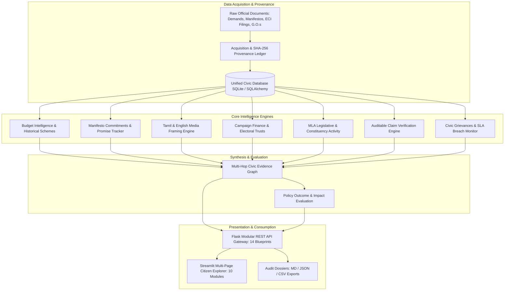

# CIVICLENS TN

[](#final-system-status)
[](#system-architecture--major-phases)
[](#testing-guide)
[](https://www.python.org/)
[](LICENSE)

An open-source, evidence-grounded civic intelligence and public accountability platform focused on the state of Tamil Nadu.

CIVICLENS TN ingests, normalizes, cross-references, and evaluates official public records—from legislative budget demands and party manifestos to campaign finance disclosures, bilingual media coverage, auditable claim verifications, citizen grievance charters, multi-hop evidence graphs, and policy outcome evaluations.

---

## 1. Problem Statement & Objectives

Public governance and budgetary records are typically distributed across fragmented government portals, scanned PDF gazettes, and disparate departmental databases. Citizens, researchers, and journalists face steep barriers when attempting to:
- Trace whether legislative budget allocations were actually disbursed and utilized.
- Verify whether election manifesto commitments materialized into funded welfare programs.
- Track local public infrastructure projects delivered by elected representatives (MLAs).
- Verify controversial political claims against primary documentary records without subjective bias.
- Audit grievance redressal turnaround times against statutory Citizen's Charter standards.
- Evaluate welfare policy outcomes (e.g. attendance, enrollment, poverty relief) with empirical rigor rather than political rhetoric.

**CIVICLENS TN** bridges this accountability gap by providing an end-to-end, multi-phase analytical engine anchored strictly in primary documentary provenance, cryptographic hashing, and non-causal epistemic discipline.

---

## 2. System Architecture & Intelligence Modules

CIVICLENS TN is organized into 10 modular, interconnected intelligence components:



### Module Breakdown
1. **Budget Execution & Intelligence:** Ingests Demands for Grants (BE, RE, AE) from the GoTN Finance Department. Classifies expenditure into functional sectors using unsupervised clustering.
2. **Historical Scheme Normalization:** Maps historical lineages and administrative renaming of flagship welfare initiatives across decades.
3. **Political Manifesto & Promise Tracking:** Tracks 1,074 promises from election manifestos (DMK, AIADMK 2021) linked to budget line items and Government Orders.
4. **Tamil & English Media Framing:** Bilingual sentiment, entity mentions, and publisher framing analysis adhering to neutral coverage indices.
5. **Political Funding Transparency:** Ingests ECI Form 24A disclosures, Electoral Trust donations, and corporate contributions with PII masking.
6. **Representative & Constituency Activity:** Tracks legislative questions, constituency development fund (MLACDS) spending, and local public works delivery.
7. **Auditable Political Claim Verification:** Decomposes complex political statements into atomic propositions and verifies against primary sources.
8. **Citizen Grievance & SLA Intelligence:** Classifies civic complaints across 14 standardized domains with automated DPDPA 2023 PII scrubbing.
9. **Unified Civic Evidence Graph:** Connects entities across modules into an explainable, bidirectional knowledge graph with 9-factor evidence scoring.
10. **Policy Outcome & Impact Evaluation:** Tracks real-world policy outcomes against published baselines and targets with non-causal epistemic guardrails.

---

## 3. Technology Stack

- **Backend Framework:** Python 3.11+, Flask (Modular Blueprints, Flask-CORS)
- **Database & ORM:** SQLite 3, SQLAlchemy 2.0 (120 relational tables, unified schema), Alembic
- **Machine Learning & NLP:** Scikit-Learn (K-Means, DBSCAN, PCA), Sentence-Transformers, Indic-NLP, SpaCy
- **Document Processing:** PDFPlumber, BeautifulSoup4, Regex Sanitization
- **Frontend Framework:** Streamlit (Multi-page architecture, responsive metric cards, Plotly charts)
- **Testing & Quality:** Pytest, AnyIO, Cryptographic SHA-256 Hashing

---

## 4. Prerequisites

- **Python:** Version 3.11, 3.12, or 3.14 (64-bit)
- **Operating System:** Windows 10/11, Ubuntu 22.04+, or macOS Ventura+
- **Memory & Storage:** 4 GB RAM minimum (8 GB recommended for transformer embeddings), ~500 MB free disk space.

---

## 5. Environment Setup & Installation

### Step 1: Clone Repository
```bash
git clone https://github.com/civiclens-tn/civiclens.git
cd CIVCLENS
```

### Step 2: Set Up Python Virtual Environment
On **Windows (PowerShell)**:
```powershell
python -m venv venv
.\venv\Scripts\activate
```
On **macOS / Linux**:
```bash
python3 -m venv venv
source venv/bin/activate
```

### Step 3: Install Dependencies
```bash
pip install --upgrade pip
pip install -r requirements.txt
```

### Step 4: Configure Environment Variables
Copy the template configuration file:
```bash
cp .env.example .env
```
Default `.env` configuration:
```ini
FLASK_APP=backend/api/app.py
FLASK_ENV=production
PORT=5000
DATABASE_URL=sqlite:///data/processed/civiclens.db
MODEL_DIR=ml/models/
EMBEDDINGS_DIR=ml/embeddings/
DEBUG=False
SECRET_KEY=your-super-secret-key-here
```

### Step 5: Database Setup
Ensure all 120 tables are created and populated:
```powershell
python scripts/ingest_phase10_real_data.py
```

---

## 6. Startup Commands

### Option A: One-Click Launch (Backend + Next.js Frontend)
Double-click `run_all.bat` or execute in PowerShell:
```powershell
.\run_all.bat
```

### Option B: Manual Startup

**1. Start the Flask REST API Backend (Port 5000):**
```powershell
python -m flask --app backend/api/app.py run --port 5000
```
Backend runs at `http://127.0.0.1:5000/`. Verify health at `http://127.0.0.1:5000/health`.

**2. Start the Modern Next.js Dashboard Frontend (Port 3000):**
In a separate terminal:
```powershell
cd frontend
npm run dev
```
Open your browser at `http://localhost:3000/`. Next.js automatically proxies all `/api/*` requests to the Flask API.

*(Legacy Streamlit explorer is archived in `frontend_legacy/`)*

---

## 7. Testing Guide

Execute the automated test suite using `pytest`:

```powershell
# Run the complete Phase 10 unit and integration test suite (77 tests)
.\venv\Scripts\python.exe -m pytest tests/ -k "phase10" -q

# Run Phase 9 evidence graph tests (94 tests)
.\venv\Scripts\python.exe -m pytest tests/unit/ -k "phase9" -q

# Run Phase 8 grievance intelligence tests (66 tests)
.\venv\Scripts\python.exe -m pytest tests/unit/ -k "phase8" -q

# Run Phase 7 claim verification tests (43 tests)
.\venv\Scripts\python.exe -m pytest tests/unit/ -k "phase7" -q

# Verify specific individual test file
.\venv\Scripts\python.exe -m pytest tests/integration/test_phase10_end_to_end_real_data.py -v
```

---

## 8. Recommended Demonstration Workflow

For evaluators, researchers, or civic analysts, the following sequence provides a comprehensive tour of the platform:

1. **Policy Evaluation Explorer (`frontend/pages/10_Policy_Evaluation_Explorer.py`):**
   - Navigate to the **Kalaignar Magalir Urimai Thittam (KMUT)** policy.
   - Inspect the **Budget Execution View**: Observe the distinction between ₹7,000 Cr BE, ₹7,896.35 Cr RE, and Audited Actuals.
   - Review the **Indicator and Baseline Comparison**: Verify the zero-baseline protection (+11.54M beneficiaries from 0.0 baseline, percentage change safely marked `UNDEFINED_ZERO_BASELINE`).
   - Examine the **Evidence & Findings Panel**: Note the State Planning Commission study linkage (`EV-STUDY-001`) and non-causal epistemic classification.
   - Export the audit dossier in Markdown, JSON, or CSV.
2. **Evidence Graph Explorer (`frontend/pages/9_Evidence_Graph_Explorer.py`):**
   - Search for entity `POL-TN-KMUT` and observe cross-phase multi-hop edges to `SCHEME-SW-KMUT` (Phase 1), `PROMISE-DMK-2021-001` (Phase 3), and `FACILITY-PRIMARY-SCHOOLS-STATEWIDE` (Phase 5).
3. **Auditable Claim Verification (`frontend/pages/6_Claim_Verification.py`):**
   - Review atomic proposition breakdowns, bidirectional corroboration, and complete reasoning dossiers.
4. **Civic Issue Intelligence (`frontend/pages/8_Civic_Issue_Intelligence.py`):**
   - Inspect DPDPA-scrubbed grievance logs, SLA turnaround breach detection, and independent resolution verifications.

---

## 9. Final System Status & Limitations

### Final Status: **`PROJECT READY WITH KNOWN LIMITATIONS`**

### Documented Data Limitations
1. **Audit Tabling Lags:** Comptroller and Auditor General (CAG) Finance Accounts for Tamil Nadu FY 2024-25 are awaiting legislative tabling. FY 2024-25 expenditures represent Revised Estimates (RE) rather than closed audited actuals.
2. **Observational Bounds:** School attendance gains (+8.8 pp) and higher education GER gains (+4.5 pp) represent observed associations. Causality is never asserted without randomized experimental designs or microdata panel models.
3. **Appellate Window Synchronization:** Grievance and scheme appeal windows (e.g. second-tier exclusion appeals) synchronize on a quarterly schedule.

For exhaustive data lineage and methodology details, consult:
- [`docs/FINAL_PROJECT_AUDIT.md`](docs/FINAL_PROJECT_AUDIT.md)
- [`docs/FINAL_VALIDATION_REPORT.md`](docs/FINAL_VALIDATION_REPORT.md)
- [`docs/DATA_SOURCES_AND_LIMITATIONS.md`](docs/DATA_SOURCES_AND_LIMITATIONS.md)

---

## 10. Development Conclusion

The planned scope of development for CIVICLENS TN concluded at **Phase 10**. No Phase 11 features have been introduced. The codebase, database, APIs, frontend dashboards, and documentation are verified and stable.
