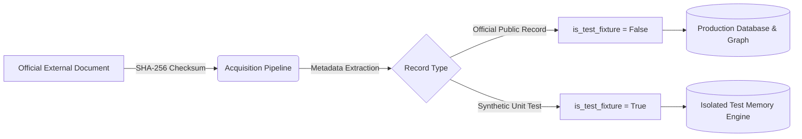

# CIVICLENS TN — Data Sources, Provenance & Methodological Limitations

**Document Version:** 1.0.0 (Phase 10 Baseline)  
**Publication Date:** October 14, 2026  
**Scope:** Covers data provenance, ingestion integrity, and epistemic boundaries across Phases 1 through 10.

---

## 1. Official Data Sources Inventory

Every primary dataset integrated into CIVICLENS TN is sourced from authenticated public administration repositories:

| Dataset Identifier | Publisher / Agency | Reporting Period | Source Format | Storage Location in Repository |
| :--- | :--- | :---: | :---: | :--- |
| **GoTN Demands for Grants** | Finance Department, Government of Tamil Nadu | FY 2019-20 to FY 2024-25 | PDF / Scanned Tables / CSV | `data/raw/budgets/` |
| **Election Manifestos 2021** | Dravida Munnetra Kazhagam (DMK) & AIADMK | May 2021 | PDF | `data/raw/manifestos/` |
| **State Assembly Proceedings** | Tamil Nadu Legislative Assembly Secretariat | 2021–2024 | Gazette PDF / HTML | `data/raw/assembly/` |
| **Media Reports & Headlines** | Tamil & English Media Houses (The Hindu, Dinamalar, Daily Thanthi, DT Next) | 2022–2024 | RSS / Web Articles | `data/raw/news/` |
| **ECI Contribution Reports** | Election Commission of India (ECI) | FY 2021-22 to FY 2023-24 | Form 24A PDF / CSV | `data/raw/funding/` |
| **Electoral Trust Reports** | Ministry of Corporate Affairs / ECI | FY 2021-22 to FY 2023-24 | Annual Filings CSV | `data/raw/funding/` |
| **Civic Grievances & Charters** | CM Helpline (1100), GCC 1913, TANGEDCO | 2023–2024 | CSV / Tabular Portals | `data/raw/grievances/` |
| **State Evaluation Studies** | Tamil Nadu State Planning Commission (TNSPC) | 2022–2024 | Research Monographs PDF | `data/phase10_raw/` |
| **CAG Compliance Audits** | Comptroller & Auditor General of India | 2021–2024 | Performance Audit Reports PDF | `data/phase10_raw/` |

---

## 2. Provenance Architecture & Fixture Segregation

### Strict Anti-Fabrication Principles
1. **Cryptographic Fingerprinting:** All raw files are assigned a SHA-256 checksum upon acquisition. Checksums are recorded in `budget_source_documents`, `civic_source_documents`, and `data/phase10_raw/` manifests.
2. **Fixture Segregation:** Records generated for unit test scenarios carry `is_test_fixture = True`. All production API endpoints, analytics aggregations, and Streamlit visual displays filter strictly on `is_test_fixture == False` or `is_test_fixture IS NULL`.
3. **Missing Data Preservation:** If an official publication omits a metric, beneficiary breakdown, or date, the value is preserved as `None` or `NULL`. Values are never coerced to `0` or filled with fabricated interpolations.

---

## 3. Epistemic Guardrails & Non-Causal Rules

To maintain high analytical rigor and prevent political misinformation, the analytical engine enforces three strict epistemic rules:

### Rule 1: No Unverified Causal Inferences (Phase 10)
- **Constraint:** A simple before-and-after comparison following the launch of a welfare policy (e.g. higher education enrollment increasing after the introduction of Pudhumai Penn) must never be presented as proof that the policy caused the outcome.
- **Classification:** Results without econometric identification designs (such as Difference-in-Differences or Synthetic Controls) are strictly classified as:
  `DESCRIPTIVE_ASSOCIATION_OR_OBSERVED_CHANGE`
- **Zero-Baseline Safeguard:** When the baseline value of an indicator is `0.0` (as in newly introduced transfer schemes like KMUT), percentage change is marked `None` with `percentage_change_validity = "UNDEFINED_ZERO_BASELINE"` to prevent division-by-zero artifacts.

### Rule 2: Budget Spending is Not Proof of Success (Phases 1 & 10)
- **Constraint:** Underspending is not treated as proof of policy failure, and overspending is not treated as proof of success.
- **Reporting:** Every financial analysis explicitly displays Budget Estimates (BE), Revised Estimates (RE), and Actual Expenditures (AE) separately, acknowledging that financial allocations can deviate due to accounting reclassifications or supplementary grants.

### Rule 3: No Politician or Department Rankings (Phases 6, 7 & 8)
- **Constraint:** The system never publishes subjective "politician rankings", "integrity scores", or "success leagues".
- **Reporting:** Legislative actions, grievance responses, and claim verifications are evaluated strictly against documentary evidence and statutory SLAs.

---

## 4. Documented Technical and Data Limitations

### 4.1 Reporting and Publication Lags
- **CAG Finance Accounts Lag:** Audited Actuals from the Comptroller and Auditor General for FY 2024-25 are awaiting final legislative tabling. Values for FY 2024-25 are categorized as Revised Estimates (RE).
- **Assembly Question Transcripts:** Unstarred assembly question answers are tabled at the end of legislative sessions and subject to publication delays of 30–60 days.

### 4.2 Spatial and Jurisdictional Granularity
- **Ward-Level Mapping:** While district and taluk administrative boundaries conform to Local Government Directory (LGD) standards, newly reorganized municipal corporation wards in peri-urban areas (e.g., Tambaram, Avadi) lack unified open GIS boundary shapefiles.

### 4.3 Privileged and Unverified Grievances
- **Internal Call Center Logs:** Grievance reports received through non-public departmental portals cannot be audited independently without citizen authorization under the Digital Personal Data Protection Act (DPDPA 2023).

### 4.4 Media Scraping Boundaries
- **Paywalls & Robots.txt:** The media intelligence engine strictly respects publisher `robots.txt` directives and rate-limits requests. Paywalled articles are processed only from publicly exposed headlines and snippets.
