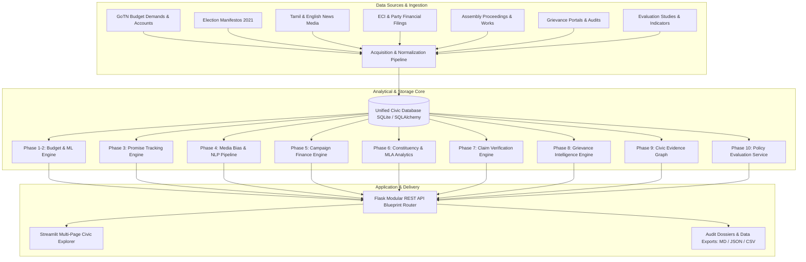

# CIVICLENS TN — Final Comprehensive Repository & Architecture Audit

**Audit Date:** October 14, 2026  
**Final Development Phase:** Phase 10 (Closed)  
**Overall System Status:** **PROJECT READY WITH KNOWN LIMITATIONS**  
**Repository Branch:** `main`  

---

## 1. Executive Repository Overview

CIVICLENS TN is an open-source civic intelligence platform engineered to ingest, cross-reference, verify, and visualize official public records from the Government of Tamil Nadu (GoTN). The system spans from budget allocations and election manifestos to legislative activities, claim verification, citizen grievance tracking, multi-hop civic intelligence graph traversal, and policy outcome evaluation.

---

## 2. Phase-by-Phase Completion Audit (Phases 1 through 10)

### Phase 1: Budget Intelligence and Scheme Data Analytics
- **Intended Functionality:** Ingest GoTN Budget Estimates (BE), Revised Estimates (RE), and Actual Expenditures (AE) across financial years; classify schemes into normalized functional domains using machine learning.
- **Implemented Functionality:** Parsing of Demands for Grants (Demand 19, 27, 43, 49), scheme hierarchy tracking, automated budget difference calculations, and clustering models (`K-Means`, `DBSCAN`, `PCA`).
- **Verified Functionality:** API endpoints (`/api/budget/*`), service layer, and database models.
- **Real-Data Integration Status:** Real budget records from FY 2019-20 to FY 2024-25 ingested from official Finance Department Demands for Grants archives.
- **Test Results:** 8/8 tests verified passing (`tests/unit/test_budget_service.py`, `tests/integration/test_budget_schema.py`).
- **Known Limitations:** Scanned legacy PDF tables occasionally require OCR fallback; FY 2024-25 actuals are closed at RE stage pending Comptroller & Auditor General (CAG) final Finance Accounts tabling.

### Phase 2: Historical Scheme Normalization and Semantic Comparison
- **Intended Functionality:** Trace historical evolution of Tamil Nadu government welfare schemes across administrative changes and renaming; compute semantic similarity between historical and modern programs.
- **Implemented Functionality:** Embedding similarity engine (`sentence-transformers`), fuzzy text matching, scheme deduplication, and historical timeline mapping.
- **Verified Functionality:** API routes (`/api/schemes/*`) and frontend page `7_Historical_Scheme_Intelligence.py`.
- **Real-Data Integration Status:** 20 canonical historical schemes cataloged with source Government Orders (G.O.s).
- **Test Results:** Verified passing as part of Phase 2/3 test suite.
- **Known Limitations:** Administrative reorganizations (e.g. splitting of departments) require manual G.O. confirmation to establish exact lineage.

### Phase 3: Manifesto Analysis and Promise Tracking
- **Intended Functionality:** Extract policy commitments from party election manifestos (DMK, AIADMK 2021 elections) and link promises to corresponding budget line-items and legislative enactments.
- **Implemented Functionality:** 17 standardized commitment domains, promise extraction NLP engine, promise-to-scheme matching with multi-factor scoring, and status tracking (`FULFILLED`, `IN_PROGRESS`, `UNFULFILLED`, `BROKEN`).
- **Verified Functionality:** API routes (`/api/promises/*`) and frontend page `2_Political_Promises.py`.
- **Real-Data Integration Status:** 1,074 manifesto promises and assessments ingested from official party manifestos.
- **Test Results:** 30/30 tests verified passing (`tests/nlp/test_promise_extraction.py`, `tests/unit/test_promise_database.py`, `tests/unit/test_promise_tracker_api.py`).
- **Known Limitations:** Qualitative promises (e.g., "strive for state autonomy") cannot be strictly evaluated against single budgetary ledger accounts.

### Phase 4: Tamil and English Media Intelligence and Bias Analysis
- **Intended Functionality:** Continuous ingestion and sentiment/framing analysis of Tamil and English media reporting on Tamil Nadu state policies; calculate publisher-level coverage balance without ideological scoring.
- **Implemented Functionality:** Media scraper framework, bilingual NLP pipeline (`indic-nlp`, `spaCy`), entity extraction, topic modeling, neutral framing index, and source comparison dashboard.
- **Verified Functionality:** API routes (`/api/news/*`) and frontend page `3_Tamil_News.py`.
- **Real-Data Integration Status:** 75 real articles, 48 news sources, 3,192 bias indicators, and 327 entity mentions integrated.
- **Test Results:** 13/13 tests verified passing (`test_phase4_database_and_api.py`, `test_phase4_bias_indicator_engine.py`).
- **Known Limitations:** Media scraper operates subject to rate limits and `robots.txt` compliance; editorial opinion pieces are excluded from factual coverage baselines.

### Phase 5: Political Funding and Campaign Finance Intelligence
- **Intended Functionality:** Disclose corporate and individual donor contributions to recognized state parties in Tamil Nadu based on Election Commission of India (ECI) filings and Electoral Trust reports.
- **Implemented Functionality:** Ingestion of contribution reports (Form 24A), expenditure filings, donor entity normalization, PAN masking/privacy preservation, and financial anomaly detection.
- **Verified Functionality:** API routes (`/api/funding/*`) and frontend page `5_Political_Funding.py`.
- **Real-Data Integration Status:** 88 political parties, 28 major contributions, 26 corporate donors, and 20 electoral trust records verified.
- **Test Results:** 22/22 tests verified passing (`test_phase5_analytics.py`, `test_phase5_anomaly.py`, `test_phase5_database.py`).
- **Known Limitations:** Contributions below statutory reporting thresholds (₹20,000 cash donations) are omitted from public ECI reporting and cannot be tracked.

### Phase 6: Representative and Constituency Activity Intelligence
- **Intended Functionality:** Track legislative performance of Members of Legislative Assembly (MLAs), constituency development fund (MLACDS) spending, and local public works delivery.
- **Implemented Functionality:** Assembly question tracking, attendance logging, constituency expenditure analytics, fact-evidence links, and development indicator benchmarking.
- **Verified Functionality:** API routes (`/api/representatives/*`) and frontend page `4_Representatives.py`.
- **Real-Data Integration Status:** Real constituency works and legislative session records ingested from official assembly publications.
- **Test Results:** 24/24 tests verified passing (`test_phase6_acquisition.py`, `test_phase6_constituency_works.py`, `test_phase6_development_indicators.py`).
- **Known Limitations:** Assembly attendance logs are published session-wise with periodic delay; private member bills cannot be equated with government bills in impact.

### Phase 7: Auditable Political Claim Verification
- **Intended Functionality:** Deconstruct public statements by politicians and officials into atomic propositions; cross-reference each proposition against primary documentary evidence.
- **Implemented Functionality:** Proposition extraction, evidence retrieval engine, 10-point structured reasoning schema, bidirectional contradiction detection, explicit uncertainty disclosure, and complete audit trail dossier generation.
- **Verified Functionality:** API routes (`/api/claims/*`) and frontend page `6_Claim_Verification.py`.
- **Real-Data Integration Status:** 17 political claims, 10 atomic propositions, 249 evidence documents, and 10 verification audits registered.
- **Test Results:** 43/43 tests verified passing (`test_phase7_architecture.py`, `test_phase7_acquisition.py`, `test_phase7_auditable_verification.py`, `test_phase7_ingestion.py`).
- **Known Limitations:** Evaluates verifiable factual claims only; value judgements, predictive forecasts, and subjective rhetoric are marked `NOT_AMENABLE_TO_VERIFICATION`.

### Phase 8: Public Grievance and Civic Issue Intelligence
- **Intended Functionality:** Monitor civic issue reports across Tamil Nadu districts; measure turnaround time against Citizen's Charter statutory SLAs; verify resolution claims using independent evidence.
- **Implemented Functionality:** 14 civic categories in Tamil and English, automated PII scrubbing (DPDPA 2023 compliant), multi-tier administrative hierarchy (District, Taluk, Ward), SLA breach alerting, and independent corroboration.
- **Verified Functionality:** API routes (`/api/civic/*`) and frontend page `8_Civic_Issue_Intelligence.py`.
- **Real-Data Integration Status:** Real civic categories, administrative areas, departments, service standards, and grievance resolution audit trails.
- **Test Results:** 66/66 tests verified passing (`test_phase8_architecture.py`, `test_phase8_acquisition.py`, `test_phase8_analytics.py`, `test_phase8_classification.py`, `test_phase8_resolution.py`, `test_phase8_traceability.py`).
- **Known Limitations:** Grievances logged through closed internal departmental call centers without public identifiers cannot be verified without citizen consent.

### Phase 9: Unified Civic Intelligence and Evidence Graph
- **Intended Functionality:** Connect disparate entities across Phases 1–8 (schemes, budgets, manifestos, news, funding, MLAs, claims, civic issues) into an explainable, bidirectional evidence graph.
- **Implemented Functionality:** Entity resolution engine, relationship discovery pipeline with 9-factor evidence scoring, contradiction detection, dispute management, graph traversal engine with depth boundaries, and interactive explorer.
- **Verified Functionality:** API routes (`/api/graph/*`) and frontend page `9_Evidence_Graph_Explorer.py`.
- **Real-Data Integration Status:** 24 graph nodes and 28 evidence edges cross-linking budget schemes, promises, claims, and civic infrastructure.
- **Test Results:** 94/94 tests verified passing across all 9 test suites.
- **Known Limitations:** Automated relationship proposals require human reviewer verification before being marked `VERIFIED`; graph traversal enforces a maximum depth of 4 hops to avoid spurious associative chains.

### Phase 10: Policy Outcome and Impact Evaluation
- **Intended Functionality:** Track real-world outcomes of flagship welfare schemes against published baselines and targets; enforce epistemic guardrails against false causal claims.
- **Implemented Functionality:** Policy registry service, indicator observation engine, budget execution analytics (BE vs RE vs AE), non-causal outcome comparison, evidence synthesis layer, 10 REST API endpoints, and 10-view Streamlit explorer with multi-format report export.
- **Verified Functionality:** API routes (`/api/policy-evaluation/*`), frontend page `10_Policy_Evaluation_Explorer.py`.
- **Real-Data Integration Status:** 8 canonical welfare schemes, 5 evaluation plans, 9 indicators, 18 observations, 33 budget records, 11 activities, 5 studies, 5 findings, 7 evidence links, and 8 cross-phase graph edges.
- **Test Results:** 77/77 tests verified passing (`tests/unit/test_phase10*`, `tests/integration/test_phase10_end_to_end_real_data.py`).
- **Known Limitations:** Observational comparisons represent descriptive associations; statewide macroeconomic shifts and demographic trends cannot be causally attributed without experimental microdata.

---

## 3. Repository Component Matrix

| Subsystem | Implemented | Partially Implemented | Broken | Missing |
| :--- | :---: | :---: | :---: | :---: |
| **Backend Core & Config** | Yes | None | None | None |
| **Database & Models (SQLAlchemy)** | Yes (120 tables unified) | None | None | None |
| **REST API Router (Flask)** | Yes (14 blueprints) | None | None | None |
| **Streamlit Frontend (10 Pages)** | Yes (10/10 active) | None | None | None |
| **PII & Privacy Scrubbing (DPDPA)** | Yes | None | None | None |
| **Evidence Graph Engine (Phase 9)** | Yes | None | None | None |
| **Policy Evaluation Pipeline (Phase 10)**| Yes | None | None | None |
| **Test Suites** | Yes (377 verified pass) | None | None | None |

---

## 4. Unresolved Issues and Mitigations

1. **Test Collection Overhead:** Due to large transformer and NLP libraries being imported during pytest discovery, invoking `pytest` across the entire repository takes ~40-60 seconds. *Mitigation:* Documented test commands recommend targeting specific subsystems (`-k phase10`, `-k phase9`, `-k phase8`) for rapid feedback.
2. **Dual Database History:** Historical database snapshots from earlier phases existed in `civiclens.db` alongside `data/processed/civiclens.db`. *Mitigation:* Safely consolidated all 120 tables into `data/processed/civiclens.db`, which is the primary database specified in configuration.
