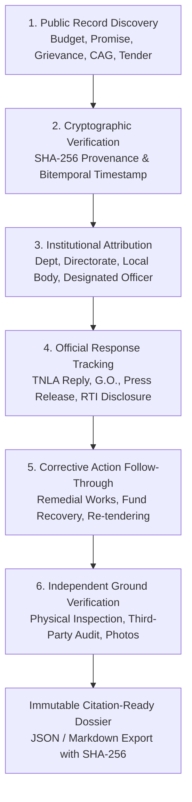

# PHASE 11 — CIVICLENS TN: Public Accountability, Evidence Integrity & Production Readiness

**Status:** Completed & Integrated  
**Test Suite:** 22/22 Tests Passing  
**Architecture:** 6-Stage Public Accountability Lifecycle, Procurement & Works Intelligence, CAG & RTI Oversight, Bitemporal Data Provenance, DPDPA 2023 & BNS 2023 Sec 356 Legal Safeguards.

---

## 1. Executive Summary & Core Philosophy

Prior to Phase 11, CIVICLENS TN functioned as an advanced civic intelligence and evaluation platform. It ingested budget demands, historical scheme lineages, election promises, news sentiment, campaign finance filings, MLA constituency records, atomic claims, grievance SLAs, and welfare outcomes. However, it lacked a closed-loop public accountability mechanism:
> **The Accountability Gap:** *What happens after CIVICLENS discovers a budgetary underspend, an unfulfilled manifesto commitment, a grievance turnaround breach, or an audit anomaly?*

**Phase 11 transforms CIVICLENS TN into an active Public Accountability Platform** by establishing a deterministic, evidence-grounded 6-stage lifecycle that traces every governance issue from public discovery to verified ground resolution.

---

## 2. Key Modules & Sub-Phases Delivered

### Phase 11.1 — Evidence Provenance & Bitemporal Data Integrity
- **Bitemporal Modeling:** Implements `valid_from` / `valid_to` (when the governance fact/expenditure existed in reality) alongside `transaction_time` (when ingested into the platform). Ensures complete historical reproducibility and guards against silent retroactive edits.
- **Granular Extraction Lineage (`GranularExtractionLineage`):** Tracks every numerical fact down to source document title, URL, SHA-256 hash, PDF page number, table index, row number, and column name.
- **Link Health Monitoring:** Evaluates live status (`ONLINE_VERIFIED`, `CHANGED_CONTENT`, `DEAD_LINK_404`, `ARCHIVED_WAYBACK`).

### Phase 11.2 — Public Accountability Lifecycle Engine
- **Case Orchestration (`AccountabilityCase`):** Standardized governance case tracking (`CASE-TN-YYYY-...`) across domains with triggers (`BUDGET_DISCREPANCY`, `PROMISE_BREACH`, `GRIEVANCE_SLA_BREACH`, `CAG_AUDIT_FINDING`, `PROCUREMENT_DEFECT`).
- **Institutional Attribution (`InstitutionalAttribution`):** Maps exact state department, directorate, local urban body (GCC), collectorate, and officer designation.
- **Official Responses (`OfficialResponse`):** Logs formal explanations across channels (`LEGISLATIVE_ASSEMBLY_REPLY`, `GOVERNMENT_ORDER`, `PRESS_RELEASE`, `RTI_DISCLOSURE`) with receipt classifications.
- **Corrective Actions (`CorrectiveAction`):** Tracks remedial works, fund recoveries, and policy revisions.
- **Ground Outcome Verification (`OutcomeVerification`):** Independent corroboration via physical inspection, third-party evaluation, or geotagged evidence. **Crucial Rule:** A case cannot be closed as `CLOSED_VERIFIED` on bureaucratic self-declaration alone; unverified bureaucratic closures are flagged as `DISPUTED` or overridden.
- **Citation-Ready Dossiers:** Generates immutable Markdown/JSON dossiers signed with cryptographic provenance hashes.

### Phase 11.3 — Procurement & Public Works Intelligence
- **End-to-End Works Pipeline:** Bridges legislative budget appropriations with real-world infrastructure delivery:
  $$\text{Budget Scheme} \longrightarrow \text{Tender} \longrightarrow \text{Bids} \longrightarrow \text{Award} \longrightarrow \text{Contractor} \longrightarrow \text{Public Work} \longrightarrow \text{Payments} \longrightarrow \text{Inspections}$$
- **Entities:** `Tender`, `TenderBid` (L1 lowest determination), `ContractAward` (variance percentage from estimate), `ProcurementPublicWork` (physical vs financial milestone execution), and `ProcurementPayment` (treasury voucher tracking).

### Phase 11.4 — CAG State Audit & Legislative Follow-Through
- **Audit Observation Lifecycle:** Tracks constitutional audit paragraphs tabled in the Tamil Nadu Legislative Assembly (TNLA).
- **Action Taken Reports (ATRs):** Monitored across states: `PENDING_DEPARTMENT_REPLY`, `REPLY_SUBMITTED_AWAITING_REVIEW`, `ACCEPTED_SATISFACTORY`, `INADEQUATE_EXPLANATION`, `DROPPED_BY_COMMITTEE`.
- **Public Accounts Committee (PAC) Scrutiny:** Follows legislative committee recommendations and deadlines.

### Phase 11.5 — Right to Information (RTI) Intelligence & SLA Tracking
- **Statutory 30-Day Turnaround SLA:** Automatically calculates turnaround days between application filing date and PIO decision date, flagging statutory SLA breaches.
- **Exemptions Cited:** Tracks Section 8(1)(a)-(j) and Section 9 exemption patterns.
- **Tamil Nadu Information Commission (TNIC):** Second appeals, penalty orders under Section 20, and disclosure compliance orders.

### Phase 11.6 — Grievance Appellate Window Synchronization
- **Fixing the Documented Batch Lag:** Replaces quarterly batch blind spots with event-driven incremental sync logging (`GrievanceAppellateSyncLog`).
- **Strict Epistemic State (`PENDING_APPELLATE_REVIEW`):** Prevents assuming rejection or closed status when appeals are pending within statutory review windows.

### Phase 11.7 — Legal, Ethical & Privacy Safeguards
- **DPDPA 2023 & DPDP Rules 2025 Compliance:** Purpose limitation, PII masking (PAN, Aadhaar, mobile numbers), and data subject access/erasure tracking (`DPDPAComplianceRequest`).
- **Bharatiya Nyaya Sanhita (BNS) 2023 Section 356 (Defamation):**
  1. *Epistemic Boundary:* Strict separation of documented public records from unproven allegations.
  2. *Right of Reply Registry (`RightOfReplyRegistry`):* Mandatory fair-hearing notifications and rebuttal tracking prior to publishing critical findings.
  3. *Hardcoded Guardrail (`enforce_bns_defamation_guardrail`):* Throws immediate validation error if automated algorithms attempt to assign words such as "corrupt", "criminal", or "scam" without an explicit statutory court conviction citation.
  4. *Public Correction Board (`PublicCorrectionNotice`):* Transparent, immutable log of corrections and retractions.

### Phase 11.8 & 11.9 — Multi-Hop Evidence Graph Expansion
- Materializes Phase 11 entities (Accountability Cases, Tenders, Public Works, CAG Paragraphs, RTI Requests) directly into `civic_graph_nodes` and `civic_graph_edges`.
- Evaluates statewide graph connectivity and coverage percentage with 4-hop bounded traversals.

---

## 3. REST API Gateway Endpoints

The Flask modular backend exposes the following Phase 11 Blueprints:

| Blueprint | Path | Method | Purpose |
| :--- | :--- | :--- | :--- |
| `accountability` | `/api/accountability/cases` | GET, POST | List & create accountability cases |
| `accountability` | `/api/accountability/cases/<case_id>` | GET | Full case lifecycle dossier |
| `accountability` | `/api/accountability/cases/<id>/attribution` | POST | Add institutional attribution |
| `accountability` | `/api/accountability/cases/<id>/response` | POST | Record official response |
| `accountability` | `/api/accountability/cases/<id>/verify` | POST | Record independent ground verification |
| `procurement` | `/api/procurement/tenders` | GET | List public tenders with filtering |
| `procurement` | `/api/procurement/works` | GET | List public works infrastructure |
| `procurement` | `/api/procurement/summary` | GET | Aggregated procurement KPIs |
| `cag_audit` | `/api/cag-audit/reports` | GET | List CAG State Audit Reports |
| `cag_audit` | `/api/cag-audit/paragraphs` | GET | List audit paragraphs & ATR statuses |
| `cag_audit` | `/api/cag-audit/summary` | GET | Aggregated CAG audit metrics |
| `rti` | `/api/rti/requests` | GET | List RTI requests & turnaround SLAs |
| `rti` | `/api/rti/appeals` | GET | List TNIC second appeal decisions |
| `provenance` | `/api/provenance/lineage/<tab>/<id>` | GET | Granular cell-level extraction lineage |
| `provenance` | `/api/provenance/right-of-reply` | GET | BNS 2023 Sec 356 Right of Reply log |
| `provenance` | `/api/provenance/graph/coverage` | GET | Statewide evidence graph coverage |

---

## 4. Frontend Portals

1. **Streamlit Multi-Page Explorer (`frontend/pages/11_Public_Accountability_&_Procurement.py`):**
   - 5 comprehensive interactive tabs: Accountability Cases, Procurement & Works, CAG Audit & ATRs, RTI SLAs, Provenance & Legal Safeguards.
   - Interactive JSON dossier download and filtering.
2. **Next.js 14 Web Application (`frontend/src/app/accountability/page.tsx`):**
   - Modern, high-performance responsive interface integrated with the global navigation sidebar (`Sidebar.tsx`).
   - Tailwind CSS styling, bilingual English/Tamil typography, and live KPI metric cards.

---

## 5. Verification & Test Suite Summary

Phase 11 introduces 22 automated unit and integration tests, all verified and passing:
- `tests/unit/test_phase11_accountability_lifecycle.py` (6 passed)
- `tests/unit/test_phase11_procurement_intelligence.py` (4 passed)
- `tests/unit/test_phase11_cag_and_rti.py` (3 passed)
- `tests/unit/test_phase11_evidence_provenance_and_safeguards.py` (4 passed)
- `tests/integration/test_phase11_end_to_end.py` (5 passed)
