# CIVICLENS TN — PHASE 11.1: CITIZEN-FIRST UX AUDIT & ARCHITECTURE PLAN

**Author:** Senior Full-Stack Engineer & UX Architect  
**Audit Date:** October 16, 2026  
**Target Milestone:** Phase 11 — Citizen-First UX Modernization  
**Scope:** Deep inspection of Phases 1–10, UX audit, data pipeline analysis, navigation redesign, and Sprint 11.2–11.10 roadmap.

---

## 1. Executive Summary

CIVICLENS TN is a comprehensive civic intelligence engine for Tamil Nadu with extensive analytical depth across 10 distinct phases: legislative budget demands, welfare schemes, party manifesto commitments, bilingual media framing, campaign financing, MLA constituency delivery, auditable claim verifications, public grievance tracking, multi-hop evidence graphs, and empirical policy evaluation.

However, the platform has historically been structured from the perspective of **policy researchers, data engineers, and administrative auditors** rather than **ordinary citizens**.

### The Core Problem
An ordinary citizen visiting the platform faces:
1. **Administrative & Statistical Jargon:** Acronyms like *BE/RE/AE, MLACDS, DPDPA 2023, HOA (Head of Account)* and technical labels like *"Dialectical Policy Evidence Graph"* and *"Non-Causal Epistemic Guardrails"*.
2. **Cognitive Overload:** 10 unranked menu items in the sidebar forcing users to guess where citizen-relevant information resides.
3. **Database Population Gap (Confirmed Defect):** While the backend code and models for Phase 10 exist and pass in-memory test suites, the persistent SQLite database on disk (`civiclens.db` and `data/processed/civiclens.db`) contains zero rows in `policy_registry` and related tables because the raw ingestion script was never executed against the persistent database file.
4. **Desktop-Centric Tables:** Complex horizontal financial accounting grids that collapse on mobile devices.

Phase 11 systematically addresses these barriers, transforming CIVICLENS TN into an intuitive, high-speed, citizen-friendly platform while strictly preserving 100% of the evidentiary rigor, documentary provenance, and working APIs developed in Phases 1–10.

---

## 2. Repository & Technical Inventory Audit

### 2.1. Frontend Architecture & Routing
* **Current Framework:** Next.js 14 (App Router) with React 18, TypeScript, Tailwind CSS, Lucide Icons, and Recharts.
* **Archived Legacy Frontend:** Streamlit multi-page application preserved intact in `frontend_legacy/` with 10 standalone Python pages (`1_Budget_&_Schemes.py` through `10_Policy_Evaluation_Explorer.py`).
* **Routing System:** Directory-based Next.js App Router (`frontend/src/app/`):
  * `/` (Home & Executive Overview)
  * `/promises` (Manifesto Promises Tracker)
  * `/budget` (Budget Execution & Demands)
  * `/claims` (Auditable Claim Verifier)
  * `/civic` (Civic Grievances & SLAs)
  * `/representatives` (MLAs & Legislative Activity)
  * `/funding` (Political Funding & ECI Filings)
  * `/news` (Bilingual Media Framing)
  * `/policy-evaluation` (Policy Outcome & Impact Evaluation)
  * `/graph` (Multi-Hop Civic Evidence Graph)
* **Proxy Configuration (`frontend/next.config.mjs`):** Transparent rewrites proxying `/api/:path*` to `http://127.0.0.1:5000/api/:path*` and `/backend-health` to `http://127.0.0.1:5000/health`.

### 2.2. Shared Layout & Component Inventory
* **`frontend/src/app/layout.tsx`:** Global root layout providing consistent page structure, typography, and meta tags.
* **`frontend/src/components/Sidebar.tsx`:** Left-hand navigation sidebar displaying 10 top-level modules with badge indicators.
* **`frontend/src/components/Navbar.tsx`:** Top header bar featuring global search input and live backend connection pulse pill (`/backend-health`).
* **`frontend/src/components/MetricCard.tsx`:** Reusable KPI summary card with trend indicators and icons.
* **`frontend/src/components/StatusBadge.tsx`:** Color-coded status badge for Promise, Claim, and SLA states.
* **`frontend/src/lib/api.ts`:** Universal client for asynchronous data fetching with automatic offline resilient static datasets.

### 2.3. Backend REST API Architecture
* **Framework:** Python Flask with modular Blueprints registered under `/api`.
* **CORS:** Enabled globally via `flask-cors`.
* **Blueprints (14 Modules, 120 Endpoints):**
  * `budget_bp` (`/api/budget/*`): Demands for grants, year summaries, department breakdowns, expenditure trends.
  * `schemes_bp` (`/api/schemes/*`): Canonical scheme search, lineage, source Government Orders.
  * `promises_bp` (`/api/promises/*`): Manifesto commitments, party filters, assessments, and evidence linkages.
  * `news_bp` (`/api/news/*`): Media outlets, articles, bilingual entity mentions, sentiment polarity.
  * `funding_bp` (`/api/funding/*`): ECI Form 24A party donations, Electoral Trusts, corporate contributions.
  * `representatives_bp` (`/api/representatives/*`): 234 MLAs, constituency public works, legislative questions, attendance.
  * `claims_bp` (`/api/claims/*`): Political claim verification, atomic propositions, audit confidence scoring.
  * `civic_bp` (`/api/civic/*`): 14 civic utility domains, grievance ledger, statutory Citizen's Charter SLAs.
  * `graph_bp` (`/api/graph/*`): Multi-hop entity exploration, node traversal, relationship proposals.
  * `policy_evaluation_bp` (`/api/policy-evaluation/*`): Policy registry, baseline indicators, budget execution comparison, empirical findings.
  * `ml_bp` (`/api/ml/*`): Unsupervised clustering (K-Means/DBSCAN) and budget anomaly detection.
  * `entities_bp` (`/api/entities/*`): Unified entity search and cross-referencing.

### 2.4. Database & Models
* **Engine:** SQLite 3 (`data/processed/civiclens.db` and root `civiclens.db`), managed via SQLAlchemy 2.0 ORM.
* **Unified Schema:** 120 relational tables defined in `backend/models/`:
  * `budget.py`: BudgetDepartment, BudgetScheme, BudgetRecord, BudgetStage, HistoricalScheme.
  * `manifesto.py`, `promise.py`: Manifesto, PoliticalPromise, PromiseAssessment, PromiseSchemeLink.
  * `claim.py`: PoliticalClaim, AtomicClaim, VerificationResult, ClaimEvidenceRelationship.
  * `civic_issue.py`: CivicIssue, GrievanceRecord, ServiceStandard, AdministrativeArea.
  * `representative.py`: Representative, ConstituencyWork, LegislativeActivity.
  * `funding.py`: PoliticalParty, Contribution, ElectoralTrust, Donor.
  * `news.py`: NewsArticle, NewsSource, BiasIndicator, CoverageMetric.
  * `graph.py`: CivicGraphNode, CivicEvidenceEdge, CandidateRelationshipProposal.
  * `policy_evaluation.py`: PolicyRegistryEntry, PolicyObjective, PolicyIndicator, IndicatorObservation, PolicyEvaluationPlan, EvaluationStudy, EvaluationFinding.

### 2.5. Test Infrastructure
* **Framework:** `pytest` with `anyio`.
* **Test Suites:** 377+ automated tests in `tests/`:
  * `tests/unit/`: Service and domain logic verification.
  * `tests/integration/`: End-to-end multi-tier pipeline tests.
  * `tests/nlp/`: Extraction, sentiment, and promise-matching models.
  * `tests/ml/`: Clustering and anomaly detection models.
* **Database Isolation:** Unit tests run on `sqlite:///:memory:` via session fixtures in `tests/conftest.py`.

---

## 3. Citizen Experience UX Audit (The 12 Usability Obstacles)

| # | Usability Obstacle | Current Project Reality | Citizen Impact | Severity |
| :--- | :--- | :--- | :--- | :--- |
| **1** | **Overly Technical Jargon** | Terms like *"Demands for Grants"*, *"BE vs RE vs AE"*, *"Epistemic Guardrails"*, *"DPDPA PII Scrubbing"*, *"Atomic Propositions"*, and *"MLACDS"*. | Ordinary citizens cannot decipher what the metrics mean without a public administration degree. | 🔴 High |
| **2** | **Bloated Top-Level Menu** | 10 unprioritized modules in the sidebar competing for attention. | New users experience choice overload; cannot find quick answers to everyday questions. | 🔴 High |
| **3** | **Disconnected Search** | Top navbar search is decoupled from page-level search filters; no unified question answering. | Citizens typing *"Where is my Rs 1000?"* in the header do not get a direct answer card. | 🔴 High |
| **4** | **Confusing Information Scent** | To inspect one welfare scheme (e.g. KMUT), a citizen must check Promises, Budget, Policy Results, and Graph separately. | Citizens bounce because information is fragmented across phase silos. | 🔴 High |
| **5** | **Empty State Silence** | Policy Evaluation previously returned an empty screen (`[]`) without any helpful explanation or status indicator. | Users assume the application is broken or that the government has zero policies. | 🔴 High |
| **6** | **Dense Financial Tables** | Financial tables show Head of Account numbers, demand numbers, and budget codes. | High cognitive friction; users fail to see whether funds reached their local community. | 🟡 Medium |
| **7** | **Inaccessible Source Documents** | Citations mention G.O. numbers (e.g. *"G.O. Ms No. 41"*) as raw text strings without previews or links. | Citizens cannot independently read or verify the underlying government gazette. | 🟡 Medium |
| **8** | **Complicated Technical Filters** | Filtering includes technical database statuses like `VERIFIED_CLEAR`, `AMBIGUOUS_OBJECTIVE`, `STAGE_REVISED`. | Citizens only care about *"Delivered"*, *"In-Progress"*, or *"Delayed"*. | 🟡 Medium |
| **9** | **Mobile Responsiveness Issues** | Fixed desktop sidebar and wide financial tables scroll horizontally off-screen on phones. | Over 70% of Indian civic users browse via mobile; current layout is cramped on small viewports. | 🔴 High |
| **10** | **Bilingual Accessibility** | Tamil script is present in some promise texts, but UI controls, filters, and explanations remain exclusively in English. | Non-English speaking Tamil Nadu citizens face language exclusion. | 🔴 High |
| **11** | **Inconsistent Visual Hierarchy** | Pages use varying card heights, padding, and metric designs across Phase 1 vs Phase 6 vs Phase 10. | Fragmented visual experience that lacks a cohesive product identity. | 🟡 Medium |
| **12** | **Unclear Fact-Check Verdicts** | Claim verification uses academic language (*"Non-amenable to empirical verification"*) rather than clear consumer fact-check ratings. | Citizens cannot immediately ascertain whether a political claim is true or false. | 🟡 Medium |

---

## 4. Proposed Citizen-First Navigation Architecture

### 4.1. Core Citizen Navigation (7 Destinations)
To deliver immediate clarity for ordinary citizens, the top-level navigation must be restructured into **7 intuitive, benefit-driven citizen destinations**, backed directly by existing routes:

```
[CIVICLENS TN]
  ├── 1. Home (Citizen Dashboard & Quick-Answer Bar) ─────── /
  ├── 2. Government Schemes (Welfare Programs & Benefits) ── /schemes
  ├── 3. Promises & Progress (Election Manifestos Tracker) ─ /promises
  ├── 4. Representatives (Find My MLA & Constituency) ───── /representatives
  ├── 5. Civic Issues (Complaints & Citizen's Charter SLAs) ─ /civic
  ├── 6. Verify Claims (Fact-Check Center & Rumor Buster) ── /claims
  ├── 7. Policy Results (Did the Programs Actually Work?) ── /policy-evaluation
  │
  └── ⚙️ Explore All Features (Civic Intelligence Lab) ──── /explore
        ├── Advanced Budget & Demands ───────────────────── /budget
        ├── Political Campaign Funding & Electoral Trusts ─ /funding
        ├── Bilingual News Framing & Bias Analysis ──────── /news
        └── Multi-Hop Civic Evidence Graph ──────────────── /graph
```

### 4.2. Route Mapping & Existing Backend Reuse Matrix

| Citizen Navigation Label | Route | Existing Route Reused? | Primary User Question Answered | Underlying Backend API |
| :--- | :--- | :---: | :--- | :--- |
| **Home** | `/` | Yes | *"What is happening in Tamil Nadu governance right now?"* | `/api/health`, `/api/promises/`, `/api/budget/records` |
| **Government Schemes** | `/schemes` | Yes (New View on Existing Endpoint) | *"What welfare schemes am I or my family eligible for, and what did they spend?"* | `/api/schemes/search`, `/api/schemes/categories`, `/api/budget/schemes` |
| **Promises & Progress** | `/promises` | Yes | *"Did the ruling and opposition parties deliver what they promised in their manifestos?"* | `/api/promises/`, `/api/promises/parties`, `/api/promises/categories` |
| **Representatives** | `/representatives` | Yes | *"Who is my local MLA, do they attend assembly, and what did they build in my area?"* | `/api/representatives/`, `/api/representatives/constituencies` |
| **Civic Issues** | `/civic` | Yes | *"How long does it take the government to fix water, roads, electricity, and sanitation issues?"* | `/api/civic/issues`, `/api/civic/standards` |
| **Verify Claims** | `/claims` | Yes | *"Is this political speech or WhatsApp rumor true, false, or misleading?"* | `/api/claims/search`, `/api/claims/<id>` |
| **Policy Results** | `/policy-evaluation` | Yes | *"Did major schemes like free breakfast or KMUT actually improve student attendance or income?"* | `/api/policy-evaluation/policies`, `/api/policy-evaluation/indicators` |
| **Explore All Features** | `/explore` | Yes (Consolidated Hub) | *"I want to do deep investigative research on campaign money, media bias, and budget demands."* | Central hub linking to `/budget`, `/funding`, `/news`, and `/graph` |

> [!NOTE]
> **Zero Empty Pages Guarantee:** Every single proposed destination maps directly to an existing, fully implemented backend REST blueprint. No placeholder pages will be created.

---

## 5. Deep Data & Backend Audit

### 5.1. Database State: Populated vs. Unpopulated Tables
An audit of the persistent database file (`data/processed/civiclens.db`, 7,856,128 bytes) reveals:
* **Total Schema Tables:** 120
* **Populated Tables (16 tables):**
  * `political_promises` (1,065 rows)
  * `promise_assessments` (1,065 rows)
  * `promise_assessment_history` (1,065 rows)
  * `promise_category_mappings` (2,130 rows)
  * `promise_scheme_links` (162 rows)
  * `manifesto_sources` (20 rows)
  * `manifesto_documents` (20 rows)
  * `historical_schemes` (20 rows)
  * `manifestos` (19 rows)
  * `promise_categories` (17 rows)
  * `budget_departments` (16 rows)
  * `document` (12 rows)
  * `evidence` (12 rows)
  * `source` (10 rows)
  * `political_parties` (1 row)
  * `alembic_version` (1 row)
* **Empty Tables (104 tables):**
  * `policy_registry` (0 rows)
  * `policy_objectives` (0 rows)
  * `policy_indicators` (0 rows)
  * `policy_evaluation_plans` (0 rows)
  * `indicator_observations` (0 rows)
  * `evaluation_findings` (0 rows)
  * `finding_evidence_links` (0 rows)
  * `budget_records` (0 rows)
  * `budget_schemes` (0 rows)
  * `representatives` (0 rows)
  * `political_claims` (0 rows)
  * `civic_issues` (0 rows)
  * `news_articles` (0 rows)
  * `contributions` (0 rows)
  * `civic_graph_nodes` (0 rows)

### 5.2. Root Cause Analysis: Why Did Policy Evaluation Explorer Display Zero Policies?
The audit identified the exact sequence that led to the Policy Evaluation Explorer displaying zero policies:

1. **Git Commit History Disconnect:**
   * On **October 11, 2026** (Commit `489b460f`), `civiclens.db` was committed at Phase 7.
   * On **October 14, 2026** (Commit `9bc90151`), Phase 10 was developed. The script `scripts/ingest_phase10_real_data.py` was committed along with raw data files in `data/phase10_raw/dataset9-10/civiclens_phase10_datasets/`.
   * However, `civiclens.db` was **never re-committed after Phase 10 ingestion**.
2. **In-Memory Testing Masked Persistent Gap:**
   * In automated integration tests (`tests/integration/test_phase10_end_to_end_real_data.py`), tests passed because test fixtures either operated in memory (`sqlite:///:memory:`) or were populated within the test runner scope.
3. **API Behavior:**
   * When the live Flask API receives `GET /api/policy-evaluation/policies`, it executes `db.query(PolicyRegistryEntry).all()`. Since the database table has 0 rows, it legitimately responds with `{"data": {"policies": [], "total": 0}, "status": "success"}`.
4. **Frontend Rendering:**
   * The frontend received this empty list and rendered an empty container without any explanatory guidance.
5. **Raw Data Integrity Confirmed:**
   * The raw CSV data files in `data/phase10_raw/dataset9-10/civiclens_phase10_datasets/` are authentic and intact (e.g. `policy_evaluation_schemes.csv` containing Kalaignar Magalir Urimai Thittam, Morning Breakfast Scheme, Pudhumai Penn, etc.).
   * Running `scripts/ingest_phase10_real_data.py` populates these exact records into `policy_registry`.

#### Defect Classification

| Defect / Observation | Classification | Source of Issue | Resolution Step |
| :--- | :---: | :--- | :--- |
| Policy Evaluation Explorer shows 0 policies | **Confirmed Defect** | Persistent SQLite DB unpopulated for Phase 10 tables | Run `scripts/ingest_phase10_real_data.py` into persistent database |
| Empty tables in Representatives, Budget, Claims, Civic | **Confirmed Defect** | Separate ingestion scripts exist in `scripts/` but were not unified into persistent DB | Execute and consolidate Phase 4, 5, 6, 7, 8, 10 ingestion into `data/processed/civiclens.db` |
| Client-Side Resilient Fallback Masks Backend Gaps | **Architectural Observation** | `src/lib/api.ts` safely falls back to local data to prevent crashes | Ensure persistent DB is fully populated so API always returns primary ground truth |

---

## 6. Component Reusability & Target Improvements

### 6.1. Reusable Components to Retain
* **`MetricCard.tsx`:** Clean, responsive, glassmorphism KPI card. Retain for all high-level figures.
* **`StatusBadge.tsx`:** Standardized visual badge with clean status mapping (`Fulfilled`, `In-Progress`, `Broken`, `SLA Breached`, `Verified True`). Retain across all pages.
* **`next.config.mjs` API Proxy:** Retain transparent rewrites to eliminate CORS issues and support direct relative fetching.
* **`src/lib/types.ts`:** Comprehensive TypeScript definitions aligned with backend SQLAlchemy models.

### 6.2. Components Requiring Improvement
* **`Sidebar.tsx`:** Currently displays 10 flat technical items. Needs to be reorganized into the 7 citizen destinations + 1 "Explore All" accordion, with an interactive mobile hamburger drawer.
* **`Navbar.tsx`:** Currently has a static search input. Needs to be connected to a universal quick-answer autocomplete modal.
* **`ClaimsPage` (`src/app/claims/page.tsx`):** Technical "Atomic Proposition" framing needs to be complemented with a consumer-friendly **"Verdict Card"** (Truth Meter, Claim, Fact, Evidence Link).
* **`BudgetPage` (`src/app/budget/page.tsx`):** Replace raw financial codes with simple visual bars: *"Planned Allocation"* vs *"Actual Money Disbursed"*.
* **`PolicyEvaluationPage` (`src/app/policy-evaluation/page.tsx`):** Add plain-language outcome summary banners (*"Did it work? Yes — 14.8% increase in attendance"*).

### 6.3. New Components to Introduce in Phase 11
* **`MobileNav.tsx`:** Slide-out mobile menu drawer for smartphone viewports.
* **`CitizenSearchModal.tsx`:** Global popup search that returns instant answers across schemes, promises, and fact-checks.
* **`PlainSummaryBanner.tsx`:** High-visibility banner converting technical findings into simple language.
* **`SourceDocumentViewerModal.tsx`:** Embedded dialog allowing citizens to view the exact Tamil Nadu Government Gazette (G.O.) proving a claim.
* **`LanguageToggle.tsx`:** Seamless English ↔ Tamil (தமிழ்) toggle for main navigation and core cards.

---

## 7. Phased Implementation Roadmap (Phases 11.2 – 11.10)

```mermaid
flowchart LR
    P11_2[11.2: Database Ingestion & API Fix] --> P11_3[11.3: Navigation & Mobile Drawer]
    P11_3 --> P11_4[11.4: Universal Search Modal]
    P11_4 --> P11_5[11.5: Citizen Schemes View]
    P11_5 --> P11_6[11.6: Promises Redesign]
    P11_6 --> P11_7[11.7: MLA Representative Finder]
    P11_7 --> P11_8[11.8: Civic Complaints Monitor]
    P11_8 --> P11_9[11.9: Fact-Check & G.O. Viewer]
    P11_9 --> P11_10[11.10: E2E Verification & Audits]
```



### Phase 11.2: Persistent Database Ingestion & API Data Verification
* **Goal:** Populate the persistent SQLite database (`data/processed/civiclens.db`) with real records from Phases 1–10, resolving the empty policy evaluation table defect once and for all.
* **Actions:**
  1. Execute `scripts/ingest_phase10_real_data.py` against `data/processed/civiclens.db`.
  2. Verify all 8 canonical welfare policies, 9 indicators, 18 observations, and evaluation findings populate cleanly.
  3. Verify API endpoint `GET /api/policy-evaluation/policies` returns 8+ policies with HTTP 200.
* **Test Criteria:**
  ```powershell
  python -c "import sqlite3; c = sqlite3.connect('data/processed/civiclens.db').cursor(); assert c.execute('SELECT COUNT(*) FROM policy_registry').fetchone()[0] >= 8; print('PASS: PolicyRegistry populated')"
  ```

### Phase 11.3: Citizen Navigation & Mobile Drawer Implementation
* **Goal:** Reorganize navigation into the 7 citizen destinations + "Explore All Features", with full mobile responsiveness.
* **Actions:**
  1. Update `Sidebar.tsx` with citizen-friendly labels: Home, Government Schemes, Promises & Progress, Representatives, Civic Issues, Verify Claims, Policy Results, Explore All.
  2. Add `MobileNav.tsx` drawer triggered by a header hamburger menu for screens `< 1024px`.
  3. Add active state highlights and category counts.
* **Test Criteria:**
  - Verify all 8 menu links route to valid pages with zero 404 errors.
  - Test responsive layout on mobile viewport (375px width).

### Phase 11.4: Universal Citizen Search & Quick-Answer Bar
* **Goal:** Allow citizens to ask natural questions in English or Tamil from anywhere on the platform.
* **Actions:**
  1. Create `CitizenSearchModal.tsx` supporting instant keyboard shortcut (`Ctrl+K` / `Cmd+K`).
  2. Index promises, schemes, MLAs, and claims for real-time client-side search.
  3. Display direct answer cards with source links.
* **Test Criteria:**
  - Typing "breakfast" returns the Chief Minister Morning Breakfast Scheme card with budget and beneficiary stats.

### Phase 11.5: Simplified Government Schemes & Citizen Benefits View
* **Goal:** Create `/schemes` providing clear welfare benefit cards for citizens.
* **Actions:**
  1. Build `/schemes/page.tsx` displaying flagship programs (KMUT ₹1,000, Free Bus Pass, Pudhumai Penn, Breakfast Scheme).
  2. Filter by beneficiary group: Women, Students, Farmers, Senior Citizens.
  3. Display eligibility criteria, benefits, and budget spent in simple terms.
* **Test Criteria:**
  - Verify cards render correctly with beneficiary filters and budgetary allocations.

### Phase 11.6: Promises & Progress Plain-Language Redesign
* **Goal:** Make manifesto tracking intuitive for first-time voters and citizens.
* **Actions:**
  1. Simplify status tags: *"Delivered"* (Green), *"In Progress"* (Blue), *"Delayed / Stalled"* (Amber), *"Broken"* (Red).
  2. Highlight bilingual text with clear Tamil script typography.
  3. Add summary progress bar showing delivered percentage.
* **Test Criteria:**
  - Verify filtering by party (`DMK` vs `AIADMK`) and status updates lists and metrics instantly.

### Phase 11.7: Representative & MLA Local Delivery Lookup
* **Goal:** Enable citizens to easily find their MLA by district or constituency.
* **Actions:**
  1. Add district and constituency filter dropdowns to `/representatives`.
  2. Display simple scorecard: Assembly Attendance, Questions Asked, and Local MLACDS Fund Spending.
  3. Highlight local public works completed (schools, roads, community halls).
* **Test Criteria:**
  - Searching "Kolathur" or "Edappadi" returns MLA details and fund utilization.

### Phase 11.8: Civic Complaints & SLA Redressal Dashboard
* **Goal:** Allow citizens to check statutory resolution deadlines for civic complaints.
* **Actions:**
  1. Group complaints into plain categories: Drinking Water, Roads & Potholes, Street Lights, Garbage Collection, Ration Shops.
  2. Show statutory Citizen's Charter turnaround times (e.g. 7 days for water supply, 14 days for road repair).
  3. Clear visual alerts for SLA breaches.
* **Test Criteria:**
  - Verify complaint cards show statutory SLA vs actual elapsed days with colored breach tags.

### Phase 11.9: Interactive Fact-Check & Source Document Viewer Modal
* **Goal:** Provide citizens with transparent, trustworthy fact-checks and proof.
* **Actions:**
  1. Display truth ratings using clear badges: *Verified True*, *Partially True*, *Misleading*, *False*.
  2. Add `SourceDocumentViewerModal.tsx` showing the primary Government Order (G.O.) number, issuance date, and gazette excerpt.
  3. Enable one-click sharing of fact-check cards.
* **Test Criteria:**
  - Clicking "View Proof" on any claim opens the documentary citation modal with primary source references.

### Phase 11.10: End-to-End Verification, Performance & Citizen Accessibility Testing
* **Goal:** Rigorous verification across desktop, tablet, and mobile browsers.
* **Actions:**
  1. Run Next.js production build (`npm run build`) ensuring 0 lint or TypeScript errors.
  2. Verify backend Flask test suite (`pytest tests/`) retains 100% pass rate.
  3. Conduct accessibility audit (contrast ratios, keyboard navigation, screen-reader aria attributes).
* **Test Criteria:**
  - Clean production build with 100% test pass rate across backend and frontend.

---

## 8. Git Conventions & Discipline

* No application behavior or database records were mutated during this Phase 11.1 audit.
* All findings and architectural specifications are recorded strictly in this document.
* Future commits will follow repository conventions: `feat(phase11): ...`, `fix(phase11): ...`.
* Sprints will proceed incrementally from Phase 11.2 onward.
