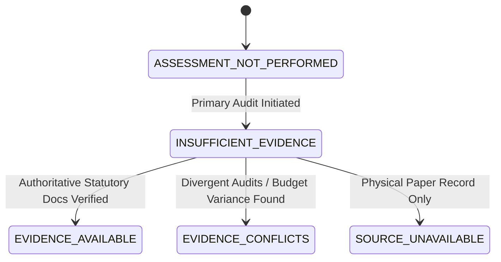

# CIVICLENS TN — Phase 11.6: Evidence and Source Explorer

## 1. Executive Summary

Phase 11.6 introduces the **Evidence and Source Explorer** across CIVICLENS TN, bridging high-level civic findings with verifiable primary documentation. The explorer empowers ordinary citizens to evaluate *where* a statement came from, *which* documents corroborate or challenge it, *who* issued each document, and *what* epistemic uncertainties remain.

Crucially, Phase 11.6 preserves strict epistemic safeguards:
- **No Path/Credential Leaks**: Internal filesystem paths (`C:\...`, `/var/...`), cloud buckets, and credentials are strictly sanitized and never exposed to the client.
- **Epistemic Principles**: Document volume is explicitly decoupled from evidence strength; absence of digitized web records is not equated with falsehood; aggregate correlation is decoupled from direct policy causation.
- **Preserved Uncertainty**: Five clear states categorize the verification status of statements without premature consensus or oversimplification.

---

## 2. Core Architecture & Endpoints

### 2.1 Backend Architecture (`backend/api/evidence.py`)

A dedicated REST API blueprint registered under `/api/evidence`:

| Endpoint | Method | Description |
| :--- | :---: | :--- |
| `/api/evidence/records/<record_type>/<record_id>` | `GET` | Compiles a comprehensive evidence dossier for any civic record type (Schemes, Promises, Representatives, Claims, Civic Grievances, Policy Evaluations). Returns supporting, conflicting, and contextual documents with epistemic rules. |
| `/api/evidence/documents/<document_id>` | `GET` | Returns sanitized metadata for a specific primary document (issuing org, publication date, source tier, checksum, verification status). |
| `/api/evidence/documents/<document_id>/view` | `GET` | Securely redirects (302) to verified external public government URLs or displays structured offline inspection instructions for physical archives. |

### 2.2 Five Distinct Epistemic Uncertainty States

1. **`EVIDENCE_AVAILABLE`** (Emerald): Verified by primary Government Gazettes, G.O.s, or audited Comptroller and Auditor General (CAG) disclosures.
2. **`EVIDENCE_CONFLICTS`** (Amber): Contradictory evidence or disputed implementation documented (e.g. partial tax cuts with unmet manifesto balance).
3. **`INSUFFICIENT_EVIDENCE`** (Purple): Initial evidence exists but lacks statutory corroboration required to determine final ground reality.
4. **`SOURCE_UNAVAILABLE`** (Slate): Source resides in physical Secretariat / Collectorate paper archives and is not yet digitized on open web portals.
5. **`ASSESSMENT_NOT_PERFORMED`** (Blue): Routine statutory reconciliation scheduled; pending departmental submission.

---

## 3. Five-Tier Source Provenance Hierarchy

| Source Tier | Legal / Credibility Weight | Typical Sources |
| :--- | :--- | :--- |
| **Tier 1: Statutory & Gazette** | Conclusive Statutory Weight | Tamil Nadu Government Gazettes, Government Orders (G.O. Ms), CAG Audit Reports, Assembly Proceedings. |
| **Tier 2: Official Line Agency** | Authoritative Operational Weight | Line Department Annual Performance Reports, Municipal Dashboards, TNeGA Open Data Portals. |
| **Tier 3: Independent Audit & Fact-Check** | Empirical Methodological Weight | Tamil Nadu State Planning Commission evaluations, academic econometric studies, accredited fact-checkers. |
| **Tier 4: Secondary Civic & Media** | Corroborative Observational Weight | Reputable journalistic investigations, televised press conferences, published party manifestos. |
| **Tier 5: Public Submission / Unverified** | Provisional Weight | Citizen grievance descriptions, rally speech transcripts, social media posts pending field inspection. |

---

## 4. Reusable Frontend Evidence Panel (`EvidencePanel.tsx`)

The `EvidencePanel` component (`frontend/src/components/EvidencePanel.tsx`) has been integrated into `RecordDetailLayout.tsx` across all detail views.

### Key Capabilities:
1. **Plain-Language Summary**: Citizens are presented with a clear explanation of what the records establish or dispute.
2. **Filterable Evidence Tabs**: "All Evidence", "Supporting", "Conflicting / Challenges", and "Context & Response".
3. **Relationship Pills**:
   - `supports this finding` (Green check)
   - `challenges this finding` (Amber warning)
   - `provides background` (Blue info)
   - `records an official response` (Indigo shield)
   - `reports an outcome` (Cyan chart)
4. **Citizen View vs Technical Audit Mode**:
   - *Citizen View*: Plain language, accessible tags, simplified descriptions.
   - *Technical Audit Mode*: Full SHA-256 integrity checksums, Source Tier hierarchy weights, Graph Node IDs, and deep links to `/graph`.
5. **Safe Document Actions**:
   - *Online*: Opens validated external link in new tab with `target="_blank" rel="noopener noreferrer"`.
   - *Offline / Physical Archive*: Expandable accordion explains *why* the document is offline, *who* published it, and *how* the citizen can inspect the physical archive or request via RTI.
6. **Epistemic Principles Accordion**: Educates users that high document volume does not equal truth, absence of digital files does not equal falsity, and correlation does not equal causation.

---

## 5. Automated Verification Results

### 5.1 Pytest Suite (`tests/api/test_evidence_api.py`)
10 dedicated unit and integration tests verifying all evidence scenarios:
- `test_scheme_evidence_dossier` (PASSED)
- `test_promise_conflicting_evidence_dossier` (PASSED)
- `test_claim_conflicting_evidence_dossier` (PASSED)
- `test_representative_evidence_dossier` (PASSED)
- `test_civic_issue_evidence_dossier` (PASSED)
- `test_policy_evaluation_evidence_dossier` (PASSED)
- `test_fallback_unregistered_record` (PASSED)
- `test_document_metadata_sanitization` (PASSED)
- `test_offline_document_safe_guidance` (PASSED)
- `test_document_viewer_safe_redirect_and_offline_notice` (PASSED)

**All 55 API tests across Phases 1–11.6 passed (100% pass rate).**

### 5.2 TypeScript & Frontend Verification
- Type check: `npx tsc -p frontend --noEmit` exited cleanly with `0` errors.
- Component renders in `RecordDetailLayout.tsx` with full backward compatibility.
