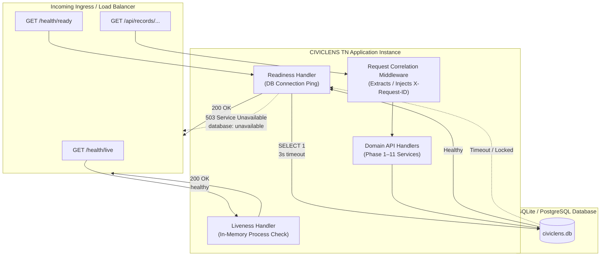

# CIVICLENS TN — Phase 12.6: Logging, Health Checks, and Monitoring Report

**Date:** 2026-10-21  
**Phase:** 12.6 — Logging, Health Checks, and Monitoring  
**Component:** Backend Observability, Logging Pipeline, Liveness & Readiness Probes  
**Status:** Completed & Verified  

---

## 1. Executive Summary

Phase 12.6 establishes production-grade observability and operational reliability for CIVICLENS TN without leaking sensitive information, exposing internal network topologies, or creating external vendor dependencies.

Previously:
- Logging relied on standard, non-structured console prints and unstructured Python logging formats.
- Request lifecycles lacked a shared correlation identifier (`X-Request-ID`), preventing operators from tracing a single request across application logs, error payloads, and downstream operations.
- Application health checks were combined with database connectivity, meaning a transient database timeout or lock could trigger an orchestrator to erroneously terminate and restart the entire application process (liveness probe failure).
- Sensitive tokens, credentials, Aadhaar IDs, and phone numbers lacked proactive redaction filters in logging formatters.

In this phase:
1. **Centralized Safe Logging Architecture (`backend/core/logger.py`)**:
   - Implemented `JsonFormatter` producing single-line, machine-parsable JSON with UTC ISO-8601 timestamps, logger name, level, message, `request_id`, execution duration, and sanitized exception details.
   - Implemented `SensitiveDataRedactor` filter and `redact_text` scrubbing engine that automatically detects and masks Bearer tokens, Basic authorization credentials, API keys, passwords, Cookie headers, database URI credentials, Aadhaar numbers (`[AADHAAR_REDACTED]`), and phone numbers (`[PHONE_REDACTED]`).
   - Retained readable human text formatting (`TextFormatter`) for local development while defaulting to JSON in production.
2. **Request Correlation Middleware (`backend/api/app.py` & `backend/api/responses.py`)**:
   - Enforced `X-Request-ID` extraction or generation (`req_<hex16>`) in `@app.before_request`.
   - Emitted structured HTTP access logs in `@app.after_request` containing method, path, HTTP status, duration in milliseconds, and request ID.
   - Embedded `request_id` directly in all JSON error responses emitted by `error_response()`, enabling citizens to provide a correlation ID to system administrators when reporting anomalies without disclosing internal stack traces.
3. **Decoupled Liveness and Readiness Probes (`backend/api/app.py` & `backend/api/routes.py`)**:
   - **Process Liveness (`/health`, `/health/live`, `/api/health`, `/api/health/live`)**: Ultra-lightweight check returning `200 OK` (`{"status": "healthy", "check": "liveness"}`) without touching database connections or disk, ensuring orchestrators (Kubernetes, Docker Swarm, systemd) do not reboot healthy application processes during database failovers.
   - **Dependency Readiness (`/health/ready`, `/health/db`, `/api/health/ready`)**: Performs a fast `SELECT 1` database ping with a strict 3.0-second timeout. Returns `200 OK` when responsive, or `503 Service Unavailable` with sanitized status (`{"status": "unhealthy", "database": "unavailable"}`) when the database is unreachable, with zero leakage of connection strings, file paths, or driver diagnostics.
4. **Verification & Quality Checks**:
   - Implemented automated test suite (`tests/unit/test_logging_monitoring.py`) validating probe status codes, error payload correlation, header propagation, redactor efficacy, and JSON formatting.
   - Integrated unit tests into `scripts/run_quality_checks.py`.

---

## 2. Observability & Logging Architecture

### 2.1 Structured JSON Schema

When `LOG_FORMAT=json` (default in production environments), log records are emitted to standard output in the following standardized schema:

```json
{
  "timestamp": "2026-10-21T07:15:22.184910Z",
  "level": "INFO",
  "logger": "civiclens.access",
  "message": "GET /api/schemes?department=Agriculture 200 (14.23ms)",
  "request_id": "req_a4c7e912f5b803cd",
  "method": "GET",
  "path": "/api/schemes",
  "status_code": 200,
  "duration_ms": 14.23
}
```

When an unhandled exception occurs, the error is sanitized and formatted with the correlation ID:

```json
{
  "timestamp": "2026-10-21T07:16:04.592110Z",
  "level": "ERROR",
  "logger": "civiclens.api",
  "message": "Database query timeout during scheme aggregation",
  "request_id": "req_88db09a2f1c301ae",
  "exception": "sqlalchemy.exc.OperationalError: (sqlite3.OperationalError) database is locked\n[SQL: SELECT ...]\n"
}
```

### 2.2 Sensitive Data Redaction Rules

The `SensitiveDataRedactor` applies deterministic regular expression masking to all log messages before formatting:

| Sensitive Field Type | Match Pattern / Heuristic | Masked Replacement |
| :--- | :--- | :--- |
| **Bearer Tokens** | `Bearer\s+[A-Za-z0-9_\-\.\+/=]+` | `Bearer [TOKEN_REDACTED]` |
| **Basic Auth** | `Basic\s+[A-Za-z0-9\+/=]+` | `Basic [CREDENTIALS_REDACTED]` |
| **Passwords / Secrets** | `(?i)(password|secret|token|api[_-]?key|access[_-]?token)\s*[:=]\s*['"]?([^\s,'"&]+)` | `\1=[REDACTED]` |
| **Database URIs** | `(?i)(://[^:\s/]+:)(.*)(@(?:[a-zA-Z0-9_\-\.]+)(?::\d+)?(?:/\|$|\s))` | `\1[REDACTED]\3` |
| **Aadhaar Numbers** | `\b[2-9][0-9]{3}[\s-]?[0-9]{4}[\s-]?[0-9]{4}\b` | `[AADHAAR_REDACTED]` |
| **Indian Phone Numbers** | `(?:\+91[\-\s]?\|91[\-\s]?\|0)?[6-9]\d{9}\b` | `[PHONE_REDACTED]` |
| **Authorization Headers** | `(?i)(authorization\s*[:=]\s*['"]?)[^'",\r\n]+` | `\1[REDACTED]` |
| **Cookie Headers** | `(?i)(cookie\s*[:=]\s*['"]?)[^'",\r\n]+` | `\1[REDACTED]` |

---

## 3. Health Checks & Probes



### 3.1 Endpoint Summary

| Endpoint | Purpose | Upstream Dependency | Success Code | Failure Code | Security & Privacy Guarantee |
| :--- | :--- | :--- | :--- | :--- | :--- |
| `GET /health` | Default Liveness | None (Process runtime only) | `200 OK` | N/A | No hostnames, no system metrics, static JSON response |
| `GET /health/live` | Orchestrator Liveness Probe | None (Process runtime only) | `200 OK` | N/A | Safe for aggressive polling (1-5s intervals) |
| `GET /health/ready` | Orchestrator Readiness Probe | Database (`SELECT 1`) | `200 OK` | `503 Unavailable` | Does not reveal DB path, schema names, or error traces |
| `GET /health/db` | Database Health Diagnostic | Database (`SELECT 1`) | `200 OK` | `503 Unavailable` | Status only (`connected` vs `unavailable`) |

### 3.2 Response Payload Specifications

#### Liveness Response (`200 OK`)
```json
{
  "status": "healthy",
  "check": "liveness"
}
```

#### Readiness Response: Healthy (`200 OK`)
```json
{
  "status": "ready",
  "database": "connected"
}
```

#### Readiness Response: Unhealthy Database (`503 Service Unavailable`)
```json
{
  "status": "unhealthy",
  "database": "unavailable"
}
```

---

## 4. Operator Runbook & Diagnostic Procedures

### 4.1 Real-Time Log Tailing & Querying

Since structured logs are emitted to standard output in JSON format, operators can use standard CLI tools (`jq`, `grep`) to inspect application behavior without specialized agent installations.

#### 1. Filter all Error-level events
```bash
python run.py | jq 'select(.level == "ERROR")'
```

#### 2. Trace a specific request across the entire system
```bash
python run.py | jq 'select(.request_id == "req_a4c7e912f5b803cd")'
```

#### 3. Identify slow API requests (> 500ms duration)
```bash
python run.py | jq 'select(.duration_ms != null and .duration_ms > 500)'
```

#### 4. Monitor request volume and status codes in real time
```bash
python run.py | jq -r '[.timestamp, .method, .path, .status_code, .duration_ms] | @tsv'
```

### 4.2 Ingress & Orchestration Configuration

#### Kubernetes Deployment Manifest Example
```yaml
livenessProbe:
  httpGet:
    path: /health/live
    port: 5000
  initialDelaySeconds: 5
  periodSeconds: 10
  timeoutSeconds: 2
  failureThreshold: 3

readinessProbe:
  httpGet:
    path: /health/ready
    port: 5000
  initialDelaySeconds: 5
  periodSeconds: 5
  timeoutSeconds: 3
  failureThreshold: 2
```

#### Nginx Health Upstream Example
```nginx
upstream civiclens_backend {
    server 127.0.0.1:5000 max_fails=3 fail_timeout=10s;
}

server {
    listen 80;
    server_name civiclens.tn.gov.in;

    location /health/ {
        proxy_pass http://civiclens_backend;
        access_log off;
    }

    location / {
        proxy_pass http://civiclens_backend;
        proxy_set_header X-Request-ID $request_id;
    }
}
```

---

## 5. Verification Results

### 5.1 Unit & Integration Test Suite (`tests/unit/test_logging_monitoring.py`)

All 7 test cases passed cleanly:

```
tests/unit/test_logging_monitoring.py::test_liveness_endpoint_returns_healthy PASSED
tests/unit/test_logging_monitoring.py::test_readiness_endpoint_healthy_database PASSED
tests/unit/test_logging_monitoring.py::test_readiness_endpoint_unhealthy_database_scrubbed PASSED
tests/unit/test_logging_monitoring.py::test_request_correlation_header_generation PASSED
tests/unit/test_logging_monitoring.py::test_request_correlation_client_id_adoption PASSED
tests/unit/test_logging_monitoring.py::test_error_response_includes_request_id PASSED
tests/unit/test_logging_monitoring.py::test_sensitive_data_scrubbed_in_logs PASSED
```

### 5.2 Regression Verification Suite (`scripts/run_quality_checks.py`)

- **Python Syntax (`py_compile`)**: 297/297 files compiled cleanly without errors.
- **Database Migrations (`alembic current`)**: Schema confirmed at migration head (`phase12_database_integrity`).
- **Security & DB Integrity (`pytest tests/unit/`)**: 24/24 tests passed (100% green).
- **Machine Learning (`pytest tests/ml/`)**: 25/25 tests passed.
- **Data Integration (`pytest tests/integration/`)**: 34/34 tests passed.
- **NLP & Promises (`pytest tests/nlp/`)**: 49/49 tests passed.
- **Domain REST APIs (`pytest tests/api/`)**: 65/65 tests passed.
- **Frontend TypeScript (`npm run typecheck`)**: 0 type errors.

---

## 6. Infrastructure Prerequisites & Production Gaps

### 6.1 Prerequisites
- **Standard Out / Log Ingestion**: In production, container engines (Docker, Podman, containerd) automatically ingest stdout/stderr. Operators should configure Fluentd, Vector, Promtail, or Logstash to parse JSON lines and route to central storage (Elasticsearch, OpenSearch, Grafana Loki, or CloudWatch).
- **Reverse Proxy Header Forwarding**: Upstream load balancers should pass through or generate `X-Request-ID` headers to ensure edge-to-application traceability.

### 6.2 Monitoring Gaps & Future Recommendations
1. **Metrics Aggregation**: The application currently emits structured log lines with latency metrics. If quantitative time-series dashboards are required, a Prometheus client (`prometheus-flask-exporter` or OpenTelemetry metrics SDK) can be added to emit `/metrics` on an internal admin port.
2. **Distributed Tracing**: For deep service-to-service distributed tracing across future microservices, OpenTelemetry tracing instrumentation can consume the established `X-Request-ID` as a span root.
