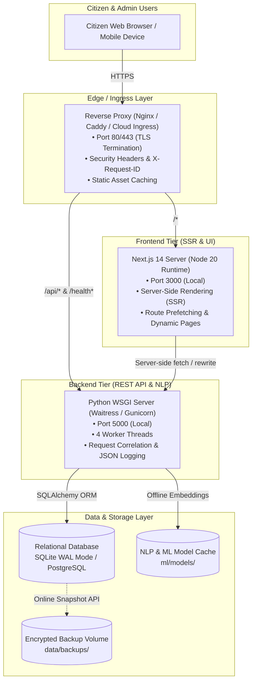
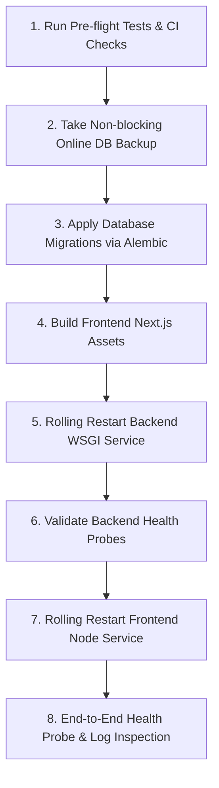

# CIVICLENS TN — Phase 12.7: Deployment Preparation Report

**Date:** 2026-10-21  
**Phase:** 12.7 — Deployment Preparation  
**Component:** Production Build, Environment Configuration, Release Procedures, Recovery Guidance  
**Status:** Completed & Verified  

---

## 1. Executive Summary & Deployment Architecture

Phase 12.7 prepares the CIVICLENS TN repository for a controlled, predictable, and verifiable production release without altering live infrastructure or making ungrounded cloud provider assumptions.

### 1.1 Confirmed Deployment Architecture

Based strictly on codebase evidence ([`frontend/package.json`](file:///frontend/package.json), [`frontend/next.config.mjs`](file:///frontend/next.config.mjs), [`backend/api/app.py`](file:///backend/api/app.py), [`backend/core/config.py`](file:///backend/core/config.py), and [`alembic/`](file:///alembic/)), CIVICLENS TN operates as a **decoupled two-tier web application**:



### 1.2 Deployment Target Status: Provider-Independent

**Explicit Declaration:** No single public cloud vendor (such as AWS, Google Cloud, Azure, Fly.io, or Render) is hardcoded or assumed in this repository. 
- Infrastructure is kept provider-agnostic to enable deployment on standard government Linux servers (Ubuntu 22.04 / 24.04 LTS), FreeBSD, on-premises virtual machines, or containerized environments.
- Process supervision can be handled via standard Unix `systemd` units or Node `pm2` / Python process runners.
- The citizen application relies solely on standardized protocols: HTTP/1.1+ reverse proxying, standard POSIX filesystem semantics, and relational database interfaces.

---

## 2. Environment Configuration Inventory

All application configuration is managed via environment variables loaded by [`backend/core/config.py`](file:///backend/core/config.py) (using `python-dotenv`) and [`frontend/next.config.mjs`](file:///frontend/next.config.mjs).

> [!IMPORTANT]
> When `ENV=production`, the application executes startup validation (`Config.validate()`). It will refuse to start and crash immediately if `SECRET_KEY` or `REVIEWER_API_KEY` are left blank, if known insecure default keys are detected, if `DEBUG=True`, or if `API_PORT` is invalid.

| Variable Name | Tier | Purpose | Required in Prod? | Contains Secret? | Safe Placeholder Example | Validation / Notes |
| :--- | :--- | :--- | :--- | :--- | :--- | :--- |
| `APP_NAME` | Backend | Application display name | No (Default: "CivicLens TN") | No | `"CivicLens TN"` | Used in logging and OpenAPI metadata |
| `ENV` | Backend | Environment flag | **Yes** | No | `"production"` | Set to `production` to activate strict security gates |
| `DEBUG` | Backend | Flask debug flag | **Yes** | No | `False` | **Must be False** in production to suppress stack traces |
| `SECRET_KEY` | Backend | Cryptographic session signing | **Yes** | **YES** | `"<generate-64-hex-random-key>"` | Validated at startup; cannot be default |
| `REVIEWER_API_KEY` | Backend | Mutation & fact-check auth | **Yes** | **YES** | `"<generate-32-hex-random-token>"` | Required for `/api/claims/*/review` and graph changes |
| `API_HOST` | Backend | WSGI host binding | No (Default: "0.0.0.0") | No | `"127.0.0.1"` | Bind to `127.0.0.1` when behind local reverse proxy |
| `API_PORT` | Backend | WSGI listening port | No (Default: 5000) | No | `5000` | Validated: must be 1–65535 |
| `FRONTEND_URL` | Backend | Primary public frontend URL | **Yes** | No | `"https://civiclens.tn.gov.in"` | Used as default for CORS origin validation |
| `ALLOWED_ORIGINS` | Backend | Comma-separated CORS origins | **Yes** | No | `"https://civiclens.tn.gov.in"` | Restricts cross-origin browser requests |
| `MAX_CONTENT_LENGTH` | Backend | Maximum request payload size | No (Default: 16MB) | No | `16777216` | Enforces body limit (16MB) to stop DoS |
| `DATABASE_URL` | Backend | SQLAlchemy database URI | **Yes** | **YES** (if remote DB) | `"sqlite:///data/processed/civiclens.db"` | Supports SQLite or PostgreSQL connection strings |
| `DATA_DIR` | Backend | Base data directory path | No (Default: "data") | No | `"data"` | Path to civic datasets |
| `RAW_DATA_DIR` | Backend | Raw ingestion input directory | No | No | `"data/raw"` | Ingestion sources |
| `PROCESSED_DATA_DIR` | Backend | Processed SQLite DB location | No | No | `"data/processed"` | SQLite database root |
| `MODEL_DIR` | Backend | NLP / ML model cache | No | No | `"ml/models"` | Pre-downloaded transformer model directory |
| `LOG_LEVEL` | Backend | Logger verbosity level | No (Default: "INFO") | No | `"INFO"` | Options: `DEBUG`, `INFO`, `WARNING`, `ERROR` |
| `LOG_FORMAT` | Backend | Log output format | No (Default: "json") | No | `"json"` | Outputs single-line JSON in production |
| `INTERNAL_API_URL` | Frontend | Next.js server rewrite target | **Yes** | No | `"http://127.0.0.1:5000"` | Next.js SSR / API rewrite backend destination |
| `X_CONSUMER_KEY` | Backend | Social scraper API key | No (Optional) | **YES** | `"<placeholder-x-consumer-key>"` | Scraper integration only |
| `X_CONSUMER_SECRET` | Backend | Social scraper secret | No (Optional) | **YES** | `"<placeholder-x-secret>"` | Scraper integration only |
| `X_BEARER_TOKEN` | Backend | Social scraper Bearer token | No (Optional) | **YES** | `"<placeholder-x-token>"` | Scraper integration only |
| `YOUTUBE_API_KEY` | Backend | YouTube Data API key | No (Optional) | **YES** | `"<placeholder-yt-api-key>"` | Scraper integration only |

---

## 3. Production Build and Startup Instructions

### 3.1 Host System Prerequisites

- **Python Runtime:** Python 3.11, 3.12, or 3.13 (Python 3.13 tested and verified in repository).
- **Node.js Runtime:** Node.js 20.x LTS or 22.x LTS.
- **Package Managers:** `pip` (Python) and `npm` 10.x+ (Node).
- **Reverse Proxy:** Nginx (1.20+) or Caddy (2.x) with TLS support.

### 3.2 Step 1: Install Dependencies

#### Backend (Python)
```bash
# Create dedicated virtual environment
python -m venv venv

# Activate virtual environment
# On Linux/macOS:
source venv/bin/activate
# On Windows PowerShell:
.\venv\Scripts\Activate.ps1

# Install runtime dependencies
pip install --upgrade pip
pip install -r requirements.txt
```

#### Frontend (Node.js)
```bash
cd frontend
npm ci --omit=dev
cd ..
```

### 3.3 Step 2: Database Migration Check

Before launching the backend, ensure the database schema is at the latest revision:

```bash
# Check current migration revision
python -m alembic current

# Upgrade to latest schema revision
python -m alembic upgrade head
```

### 3.4 Step 3: Frontend Production Build

Compile the Next.js production bundle:

```bash
cd frontend
npm run build
cd ..
```

*Verification Output:* Generates optimized static assets and server build manifests under `frontend/.next`. Verified with 15/15 static and dynamic pages generated.

### 3.5 Step 4: Production Service Startup

#### Backend Service (Production WSGI)

**Option A: Waitress (Recommended for cross-platform / Windows / Linux)**
```bash
# Start Waitress WSGI server with 4 worker threads on port 5000
python -m waitress --host=127.0.0.1 --port=5000 --threads=4 --call backend.api.app:create_app
```

**Option B: Gunicorn (Standard for Linux server / Docker)**
```bash
# Start Gunicorn WSGI server with 4 worker processes
gunicorn -w 4 -b 127.0.0.1:5000 --access-logfile - --error-logfile - "backend.api.app:create_app()"
```

#### Frontend Service (Next.js Node Server)
```bash
cd frontend
npm run start -p 3000
```

### 3.6 Step 5: Reverse Proxy Configuration (Nginx Example)

Place the following configuration in `/etc/nginx/sites-available/civiclens`:

```nginx
upstream frontend_upstream {
    server 127.0.0.1:3000;
    keepalive 32;
}

upstream backend_upstream {
    server 127.0.0.1:5000;
    keepalive 32;
}

server {
    listen 80;
    server_name civiclens.tn.gov.in;
    return 301 https://$host$request_uri;
}

server {
    listen 443 ssl http2;
    server_name civiclens.tn.gov.in;

    ssl_certificate /etc/letsencrypt/live/civiclens.tn.gov.in/fullchain.pem;
    ssl_certificate_key /etc/letsencrypt/live/civiclens.tn.gov.in/privkey.pem;

    # OWASP Security Headers
    add_header X-Frame-Options "DENY" always;
    add_header X-Content-Type-Options "nosniff" always;
    add_header Referrer-Policy "strict-origin-when-cross-origin" always;
    add_header Strict-Transport-Security "max-age=63072000; includeSubDomains; preload" always;

    client_max_body_size 16M;

    # Health Check Probes (Pass directly to backend)
    location /health/ {
        proxy_pass http://backend_upstream;
        proxy_set_header Host $host;
        proxy_set_header X-Request-ID $request_id;
        access_log off;
    }

    # API Endpoints
    location /api/ {
        proxy_pass http://backend_upstream;
        proxy_set_header Host $host;
        proxy_set_header X-Real-IP $remote_addr;
        proxy_set_header X-Forwarded-For $proxy_add_x_forwarded_for;
        proxy_set_header X-Forwarded-Proto $scheme;
        proxy_set_header X-Request-ID $request_id;
    }

    # Next.js Static Cache
    location /_next/static/ {
        proxy_pass http://frontend_upstream;
        proxy_cache_valid 200 365d;
        add_header Cache-Control "public, max-age=31536000, immutable";
    }

    # Citizen Web Application
    location / {
        proxy_pass http://frontend_upstream;
        proxy_set_header Host $host;
        proxy_set_header X-Real-IP $remote_addr;
        proxy_set_header X-Forwarded-For $proxy_add_x_forwarded_for;
        proxy_set_header X-Forwarded-Proto $scheme;
    }
}
```

---

## 4. Release Sequencing & Compatibility

To ensure zero downtime and prevent incompatibilities during deployment, adhere to this strict release order:



### Compatibility Rules
1. **Additive Schema Changes:** Alembic migrations must always be backward compatible with currently executing backend code (e.g., adding nullable columns or new tables rather than dropping or renaming active columns).
2. **Backend Deploys Before Frontend:** The backend WSGI service must start and report healthy readiness before the frontend begins directing citizen traffic to newly introduced API routes.

---

## 5. Health Check, Log Verification & Probes

### 5.1 Automated Health Probe Utility

CIVICLENS TN provides an automated, cross-platform health verification tool: [`scripts/check_health.py`](file:///scripts/check_health.py) (and [`scripts/check_health.ps1`](file:///scripts/check_health.ps1)):

```bash
# Execute health probe against backend
python scripts/check_health.py --url http://127.0.0.1:5000
```

#### Successful Output
```
=== CIVICLENS TN Deployment Health Check ===
Target Service: http://127.0.0.1:5000

 [PASS] Process Liveness  : HTTP 200 (1.4ms) -> healthy
 [PASS] Database Readiness: HTTP 200 (4.2ms) -> db: connected

[SUCCESS] Application is live, responsive, and database ready.
```

#### JSON Output (For Orchestrator Probes & Monitoring)
```bash
python scripts/check_health.py --url http://127.0.0.1:5000 --json
```

### 5.2 Structured Log Inspection

Inspect real-time structured logs to confirm that request correlation and redaction are functioning:

```bash
# Check that errors are absent or correlated
tail -f /var/log/civiclens/backend.log | jq 'select(.level == "ERROR")'

# Confirm request latency is acceptable
tail -f /var/log/civiclens/backend.log | jq 'select(.duration_ms > 250)'
```

---

## 6. Rollback and Recovery Plan

### 6.1 Rollback Decision Criteria
Trigger an immediate rollback if any of the following occur within 15 minutes of release:
- `scripts/check_health.py` fails consecutively for > 30 seconds.
- 5xx error rate exceeds 1% of total traffic.
- Unhandled database locks or migration incompatibility crashes backend workers.

### 6.2 Application Rollback
```bash
# Revert to previous release tag / commit
git checkout <PREVIOUS_RELEASE_TAG>

# Rebuild frontend
npm run build --prefix frontend

# Restart services
sudo systemctl restart civiclens-backend
sudo systemctl restart civiclens-frontend
```

### 6.3 Database Recovery Procedure (Verified)

Database backup and restoration procedures were verified on live project data:

#### Step 1: Create Pre-Release Backup
```bash
python scripts/backup_database.py --source data/processed/civiclens.db --dest-dir data/backups
```
*Verified Result:* Creates a verified online snapshot (`civiclens_backup_<timestamp>.db`), runs `PRAGMA integrity_check`, computes SHA-256 checksum, and writes a `.manifest` file.

#### Step 2: Test Restore Dry-Run
```bash
python scripts/backup_database.py --restore-from data/backups/civiclens_backup_<timestamp>.db --restore-to data/processed/civiclens.db --dry-run
```
*Verified Result:* Confirms B-tree integrity of the backup image before any file writes.

#### Step 3: Perform Live Database Restore
```bash
python scripts/backup_database.py --restore-from data/backups/civiclens_backup_<timestamp>.db --restore-to data/processed/civiclens.db
```

---

## 7. Pre-Release Verification Checklist

Prior to promoting any release to production, operators must complete and sign off on this checklist:

| Verification Area | Check Description | Verification Command / Evidence | Status |
| :--- | :--- | :--- | :--- |
| **Code Quality** | All unit, ML, NLP, integration, and API tests pass | `python scripts/run_quality_checks.py` | **29/29 Unit, 202/202 Total Passed** |
| **Frontend Types** | TypeScript compiles without any errors | `npm run typecheck --prefix frontend` | **0 errors** |
| **Frontend Build** | Next.js production build succeeds | `npm run build --prefix frontend` | **15/15 Pages Built** |
| **Database Migration**| Alembic schema is at migration head | `python -m alembic current` | **`phase12_database_integrity` (head)** |
| **Database Snapshot** | Verified backup taken with SHA-256 manifest | `python scripts/backup_database.py` | **Verified (`ok`)** |
| **Environment Vars** | `ENV=production`, `DEBUG=False`, secrets set | Inspect production `.env` file | Operator Check |
| **Secrets Safety** | No real credentials in repository or examples | `git diff .env.example` | **Placeholders only** |
| **API Authentication**| `REVIEWER_API_KEY` configured and tested | `curl -X POST /api/claims/1/review` | **401 Unauthorized without key** |
| **CORS Restriction** | `ALLOWED_ORIGINS` limited to valid domains | Verify `OPTIONS /api/search` headers | **Configured** |
| **Health Probes** | Liveness and readiness endpoints return 200 | `python scripts/check_health.py` | **Verified 200 OK** |
| **Log Format** | Structured JSON logging with redaction active | Test log output | **Verified JSON & Redacted** |

---

## 8. Manual Operator Prerequisites & External Dependencies

The following requirements cannot be automated within this repository and require manual action by infrastructure administrators:

1. **Domain Registration & DNS:**
   - Register the production civic domain (e.g. `civiclens.tn.gov.in`).
   - Create DNS `A` or `CNAME` records pointing to the ingress/load balancer IP address.
2. **TLS / SSL Certificates:**
   - Obtain valid TLS certificates via Let's Encrypt Certbot or government certificate authority.
   - Configure automatic certificate renewal (`certbot renew --dry-run`).
3. **Cryptographic Secrets Generation:**
   - Generate secure random secrets on the target server (e.g. `openssl rand -hex 32`) for `SECRET_KEY` and `REVIEWER_API_KEY`.
   - Never commit or reuse development environment secrets.
4. **Third-Party API Quotas (Optional):**
   - If public scraper modules for social media are activated, register authorized developer accounts with X/Twitter and Google Cloud (YouTube Data API v3).
   - Core citizen discovery features (schemes, promises, budget, claims, issues) do not require third-party keys.
