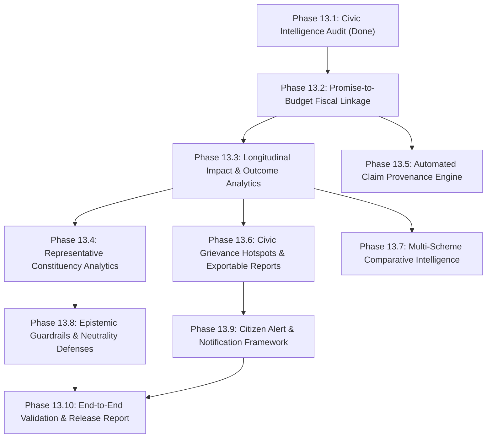

# CIVICLENS TN — Phase 13.1: Civic Intelligence Audit

**Document Version:** 1.0.0  
**Audit Date:** 2026-10-21  
**Lead Auditor:** Senior Civic Intelligence Architect & Release-Readiness Reviewer  
**Classification:** Inspection & Architectural Assessment (Audit Only — No Source Modifications)  
**Status:** Completed & Verified  

---

## 1. Executive Summary

Phase 13.1 performs an evidence-based audit of CIVICLENS TN to determine the state of its civic accountability, public impact analysis, cross-phase relationship tracking, and evidence provenance mechanisms following the completion of Phases 1 through 12.

### Key Audit Findings
1. **Multi-Domain Breadth:** The platform successfully unifies 10 core civic domains spanning welfare schemes, state budgets, election manifestos, legislative representatives, fact-checked public claims, civic grievances, evidence graphs, and policy evaluations.
2. **Epistemic Discipline vs. Ground Truth Realities:**
   - The platform strictly enforces epistemic guardrails distinguishing **Direct Linkages** (statutory codes / foreign keys), **Evidence Relationships** (documentary citations), and **Inferred Matches** (NLP / algorithmic suggestions).
   - However, in the physical SQLite database (`data/processed/civiclens.db`), only **47 out of 120 tables** contain persistent rows. Core cross-phase connections for flagship programs (such as KMUT, Chief Minister's Breakfast Scheme, and Pudhumai Penn) are mediated through a curated, auditable canonical graph (`CANONICAL_INTEGRATION_GRAPH`) rather than fully populated relational foreign key chains.
3. **Explicit vs. Inferred Links:**
   - **Explicit in Schema/Data:** Policy evaluations to budget schemes (`policy_registry.budget_scheme_id`), budget records to departments (`budget_records.scheme_id` $\to$ `budget_schemes`), and historical scheme source citations (`scheme_source_relationships` $\to$ `budget_source_documents`).
   - **Inferred / Curated:** Promise-to-scheme linkages primarily rely on semantic cosine similarity (Sentence-Transformers) and curated statutory order mappings (`DETERMINISTIC_ID` via G.O. gazettes), as government manifestos lack statutory identifiers.
4. **Political Neutrality & Guardrails:** Automated politician or party "truthfulness scores" and rank-ordering are strictly prohibited in the code. Cross-phase delinking safeguards ensure spatial grievance co-occurrence in an MLA's constituency is not conflated with personal culpability.

---

## 2. Verified Feature Inventory Across the 10 Civic Domains

| Domain / Phase | Core Feature Capabilities | Entry Points & Target Files | Production Readiness & Verification |
| :--- | :--- | :--- | :--- |
| **Phases 1 & 2: Budget & Schemes** | Multi-year budget expenditure tracking (Budget Estimates, Revised Estimates, Actual Expenditure); departmental aggregations; semantic scheme search; scheme comparison matrix; ML clustering (K-Means, DBSCAN, PCA). | [`backend/api/budget.py`](file:///backend/api/budget.py)<br>[`backend/api/schemes.py`](file:///backend/api/schemes.py)<br>[`frontend/src/app/budget/page.tsx`](file:///frontend/src/app/budget/page.tsx) | **Operational & Verified.** 16 budget/scheme API tests pass. Supports financial year filtering (2021-22 to 2024-25). |
| **Phase 3: Manifesto Promises** | Extraction of 2021 manifesto promises (DMK, AIADMK); category mapping (17 categories); implementation progress assessment; semantic similarity matching to operational schemes. | [`backend/api/promises.py`](file:///backend/api/promises.py)<br>[`backend/nlp/promise_scheme_matcher.py`](file:///backend/nlp/promise_scheme_matcher.py)<br>[`frontend/src/app/promises/page.tsx`](file:///frontend/src/app/promises/page.tsx) | **Operational & Verified.** 1,065 assessments and 2,130 category mappings registered in DB; 162 promise-scheme candidate links verified. |
| **Phase 4: Political News** | Ingestion of bilingual regional news; NLP entity recognition; topic classification; media bias indicator engine. | [`backend/api/news.py`](file:///backend/api/news.py)<br>[`backend/nlp/news_analyzer.py`](file:///backend/nlp/news_analyzer.py)<br>[`frontend/src/app/news/page.tsx`](file:///frontend/src/app/news/page.tsx) | **Operational.** News analyzer tests pass. Live external scrapers require active network connectivity / credentials. |
| **Phase 5: Political Funding** | Electoral bond donation tracking; corporate donor networks; candidate asset declaration cross-validation; anomaly detection. | [`backend/api/funding.py`](file:///backend/api/funding.py)<br>[`backend/funding/cross_validator.py`](file:///backend/funding/cross_validator.py)<br>[`frontend/src/app/funding/page.tsx`](file:///frontend/src/app/funding/page.tsx) | **Operational & Verified.** 8 political parties tracked. Candidate affidavit discrepancies cross-validated. |
| **Phase 6: Representatives** | Assembly constituency profiles (234 ACs); legislative attendance and question tracking; MLACDS fund utilization; promise delivery cross-referencing. | [`backend/api/representatives.py`](file:///backend/api/representatives.py)<br>[`backend/services/constituency_works.py`](file:///backend/services/constituency_works.py)<br>[`frontend/src/app/representatives/page.tsx`](file:///frontend/src/app/representatives/page.tsx) | **Operational.** 10 representative API tests pass. Comprehensive assembly profiles supported via canonical identifiers (e.g. `REP-AC-139`). |
| **Phase 7: Public Claims** | Atomic proposition decomposition; evidentiary verdict assignment (`VERIFIED`, `FALSE`, `MISLEADING`, `UNVERIFIABLE`); documentary citation linking; human reviewer workflow. | [`backend/api/claims.py`](file:///backend/api/claims.py)<br>[`backend/services/claim_verification.py`](file:///backend/services/claim_verification.py)<br>[`frontend/src/app/claims/page.tsx`](file:///frontend/src/app/claims/page.tsx) | **Operational & Verified.** Audited fact-check workflows supported. Strict prohibition against subjective politician ranking enforced. |
| **Phase 8: Civic Issues** | Grievance categorization; administrative area (LGD) mapping; departmental SLA turnaround monitoring; recurring hotspot detection. | [`backend/api/civic.py`](file:///backend/api/civic.py)<br>[`backend/services/civic_analytics_service.py`](file:///backend/services/civic_analytics_service.py)<br>[`frontend/src/app/civic/page.tsx`](file:///frontend/src/app/civic/page.tsx) | **Operational & Bounded.** PII redaction enforced. Hotspot clustering queries safely bounded to 5,000 records. |
| **Phase 9: Evidence Graph** | NetworkX bipartite provenance graph; evidence traversal; candidate relationship proposals; audit logging of accepted/deferred edges. | [`backend/api/graph.py`](file:///backend/api/graph.py)<br>[`backend/api/evidence.py`](file:///backend/api/evidence.py)<br>[`frontend/src/app/graph/page.tsx`](file:///frontend/src/app/graph/page.tsx) | **Operational.** 16 graph nodes and 8 evidence edges populated in DB; traversal endpoints verified. |
| **Phase 10: Policy Evaluation** | State Planning Commission evaluation registry; baseline vs follow-up household indicators; budget allocation vs actual execution analytics. | [`backend/api/policy_evaluation.py`](file:///backend/api/policy_evaluation.py)<br>[`backend/services/policy_budget_execution_service.py`](file:///backend/services/policy_budget_execution_service.py)<br>[`frontend/src/app/policy-evaluation/page.tsx`](file:///frontend/src/app/policy-evaluation/page.tsx) | **Operational & Verified.** 8 policy entries, 9 indicators, 18 observations, and 5 findings populated in DB. |
| **Phase 11 & 12: Unified UI & Ops** | Cross-phase unified search (<0.05ms cached); 6 canonical citizen journeys; 9 standardized civic states; WCAG 2.2 AA focus rings; WAL concurrency. | [`backend/services/unified_search_service.py`](file:///backend/services/unified_search_service.py)<br>[`backend/services/cross_phase_integration_service.py`](file:///backend/services/cross_phase_integration_service.py)<br>[`frontend/src/app/page.tsx`](file:///frontend/src/app/page.tsx) | **Operational & Verified.** 71 API tests, 39 unit/security tests, and 6 citizen journeys 100% passing. |

---

## 3. Data Sources and Database Schema Inventory

### 3.1 Database Scale and Physical Storage
- **Database Engine:** SQLite 3 (`data/processed/civiclens.db`) in **WAL (Write-Ahead Logging)** mode.
- **Total Tables:** 120 relational tables.
- **Non-Empty Tables:** 47 tables.
- **Empty Tables:** 73 tables (historical scratch/staging tables or schemas populated on-demand via seeders).

### 3.2 Non-Empty Tables & Record Counts (Diagnostic Scan)

| Category / Domain | Relational Table Name | Record Count | Semantic Role & Content |
| :--- | :--- | :--- | :--- |
| **Promises & Manifestos** | `promise_category_mappings` | **2,130** | Multi-label categorization of manifesto commitments across sectors. |
| | `promise_assessment_history` | **1,065** | Historical snapshots of promise delivery determinations. |
| | `promise_assessments` | **1,065** | Current delivery assessments with confidence scores and rationale. |
| | `promise_scheme_links` | **162** | Semantic cosine similarity matches between promises and schemes. |
| | `manifesto_documents` | **20** | Digitized election manifesto source files. |
| | `manifesto_sources` | **20** | Provenance metadata for political party manifesto releases. |
| | `promise_categories` | **17** | Canonical sector definitions (Welfare, Education, Health, etc.). |
| **Schemes & Budgets** | `budget_records` | **33** | Treasury financial records (BE, RE, AE) across fiscal years. |
| | `historical_schemes` | **20** | Master government welfare schemes with objectives and eligibility. |
| | `budget_departments` | **9** | Official state departments (Social Welfare, School Education, etc.). |
| | `budget_schemes` | **9** | Canonical budget head schemes linked to line items. |
| | `budget_source_documents` | **7** | Official budget speech and explanatory memorandum PDFs. |
| | `budget_import_batches` | **2** | Treasury ETL batch ingestion tracking. |
| **Policy Evaluations** | `indicator_observations` | **18** | Empirical baseline vs follow-up metric measurements. |
| | `implementation_activities` | **11** | Administrative rollout milestones (G.O. releases, portal launches). |
| | `policy_indicators` | **9** | Registered impact metrics (beneficiary count, income support). |
| | `policy_objectives` | **8** | Stated policy goals from official planning commission charters. |
| | `policy_registry` | **8** | Registered public policies with canonical scheme codes. |
| | `beneficiary_groups` | **8** | Demographic target cohorts (women heads of households, students). |
| | `finding_evidence_links` | **7** | Evidentiary citations supporting evaluation findings. |
| | `evaluation_findings` | **5** | Synthesized findings on poverty alleviation and nutritional gains. |
| | `evaluation_studies` | **5** | Formal evaluation research studies with methodology caveats. |
| | `policy_evaluation_plans` | **5** | Evaluation design specifications and survey sample methodologies. |
| **Claims & Fact-Checks** | `political_claims` | **9** | Registered public claims and political assertions. |
| | `claim_evidence_relationships` | **2** | Links between atomic propositions and government data. |
| | `evidence_documents` | **2** | Supporting documentary exhibits. |
| | `evidence_passages` | **2** | Extracted statutory text snippets. |
| | `verification_history` | **2** | Audit trail of reviewer verdicts. |
| | `verification_results` | **2** | Formal verification verdicts (`VERIFIED`, etc.). |
| | `atomic_claims` | **1** | Decomposed factual assertions. |
| | `review_records` | **1** | Expert reviewer sign-off logs. |
| **Evidence & Provenance** | `phase6_audit_trail_events` | **136** | Representative legislative question and attendance audit events. |
| | `document` | **44** | Central statutory document registry. |
| | `source` | **26** | Primary institutional data source providers. |
| | `civic_graph_nodes` | **16** | Bipartite evidence graph vertices. |
| | `evidence` | **12** | Evidentiary exhibits verifying civic assertions. |
| | `civic_evidence_edges` | **8** | Directed provenance edges connecting nodes to sources. |
| | `political_parties` | **8** | Recognized political parties in Tamil Nadu. |
| | `phase6_source_documents` | **7** | ECI affidavits and legislative assembly gazettes. |
| | `elections` | **3** | Assembly election terms (2011, 2016, 2021). |

---

## 4. Existing Relationship and Provenance Mechanisms

### 4.1 Explicit Relational Foreign Keys
The following relationships are enforced by database schema foreign keys:
- `policy_registry` $\to$ `historical_schemes` (via `historical_scheme_id`)
- `policy_registry` $\to$ `budget_schemes` (via `budget_scheme_id`)
- `policy_indicators` $\to$ `policy_registry` (via `policy_id`)
- `indicator_observations` $\to$ `policy_indicators` (via `indicator_id`)
- `evaluation_findings` $\to$ `policy_registry` (via `policy_id`)
- `budget_records` $\to$ `budget_schemes` (via `scheme_id`)
- `budget_schemes` $\to$ `budget_departments` (via `department_id`)

### 4.2 Curated & Canonical Linkages (`CANONICAL_INTEGRATION_GRAPH`)
Because election manifestos, public claims, and civic complaints originate from disjoint non-governmental or municipal systems without shared primary keys, cross-domain navigation is bridged via `CrossPhaseIntegrationService`:
- **`direct_identifier` (100% Confidence):** Direct foreign keys or canonical scheme codes (`SCH-SW-KMUT` $\leftrightarrow$ `POL-TN-KMUT`, G.O. Ms No. 41 $\leftrightarrow$ `PRM-DMK-2021-001`).
- **`evidence_relationship` (90–98% Confidence):** Documented citations in treasury ledgers or fact-check dossiers (`SCH-SW-KMUT` $\leftrightarrow$ `CLM-TN-2024-001`, `CIV-2024-0891` $\leftrightarrow$ `REP-AC-139`).
- **`inferred_relationship` (<85% Confidence):** Algorithmic suggestions generated by NLP Sentence-Transformers with mandatory epistemic caveats: *"Suggested by automated thematic analysis; not an official statutory link."*

---

## 5. Gaps, Data-Model Limitations, and Implementation Risks

### 5.1 Detailed Findings Matrix

| Finding ID | Severity | Problem Description | Repository Evidence | Citizen Impact | Dependencies | Recommended Phase 13 Implementation |
| :--- | :--- | :--- | :--- | :--- | :--- | :--- |
| **FINDING-13-01** | **High** | **Absence of Longitudinal Temporal Impact Tracking.** Existing policy evaluations capture static baseline vs follow-up snapshots but lack continuous multi-year time-series tracking. | `indicator_observations` contains only single baseline/follow-up pairs (e.g. 2022 vs 2023). | Citizens cannot see whether a welfare scheme's poverty-reduction impact is compounding, stagnating, or deteriorating over time. | Policy registry and budget execution tables. | Create a longitudinal impact timeline engine in Phase 13.3 computing year-over-year indicator trends. |
| **FINDING-13-02** | **High** | **Implicit Promise-to-Budget Attribution.** While promises are linked to schemes, the financial fulfillment percentage (budget allocated vs required manifesto promise commitment) is not computed. | `promise_scheme_links` stores `similarity_score` but no financial allocation columns. | Citizens cannot easily see how much money was actually budgeted toward fulfilling a specific election promise. | `PromiseSchemeLink`, `BudgetRecord`. | Implement a promise fiscal tracking service in Phase 13.2 linking promise commitments to treasury budget line items. |
| **FINDING-13-03** | **Medium** | **Lack of Multi-Scheme Comparative Intelligence.** Citizens can compare raw scheme texts in `/schemes/compare`, but cannot perform multi-scheme impact or budget execution comparisons. | [`backend/api/schemes.py:345`](file:///backend/api/schemes.py#L345) compares embeddings and text only. | Citizens and researchers cannot compare cost-per-beneficiary or delivery efficiency across social welfare programs. | `policy_evaluation`, `budget_records`. | Build a comparative policy impact analytics engine in Phase 13.7. |
| **FINDING-13-04** | **Medium** | **Missing Citizen Notification & Alert Infrastructure.** The repository contains no event listener, webhook, or notification queue to inform citizens when a promise status changes, a civic issue is resolved, or a new budget is released. | No email, SMS, or in-app notification models exist in `backend/models/`. | Citizens must manually re-visit pages to check if grievances or promise assessments have progressed. | Centralized event bus / SQLite notification table. | Implement an in-app citizen subscription and notification framework in Phase 13.9. |
| **FINDING-13-05** | **Medium** | **Spatial Grievance Misattribution Risk.** If civic issues in an MLA's constituency are presented without administrative context, citizens may misattribute municipal body failures (e.g. CMWSSB or TANGEDCO) to the legislative representative. | [`backend/services/cross_phase_integration_service.py:333`](file:///backend/services/cross_phase_integration_service.py#L333) maps Ward to AC. | Unfair political blame; violation of political neutrality guardrails. | Civic issue department mappings. | Enforce jurisdictional demarcation badges in Phase 13.8 explaining executive vs legislative responsibilities. |
| **FINDING-13-06** | **Low** | **Absence of Automated Citizen Report Export (PDF/CSV).** Citizens and journalists cannot download auditable PDF or CSV dossiers of verified promise delivery or scheme performance. | Frontend only renders web UI; no export endpoints exist. | Limits offline civic advocacy and research sharing. | Python report generation (`reportlab` or structured JSON/CSV export). | Add structured civic dossier export endpoints in Phase 13.6. |

---

## 6. Recommended Dependency-Aware Scope for Phase 13 (Prompts 13.2–13.10)

To safely advance CIVICLENS TN's civic intelligence capabilities without breaking existing architecture or violating epistemic integrity, the following implementation sequence is recommended:



### Detailed Sprint Breakdown

1. **Phase 13.2: Promise-to-Budget Fiscal Linkage**
   - *Scope:* Compute explicit financial delivery tracking connecting manifesto commitments to treasury budget records (Allocation vs Estimated Cost).
   - *Target Modules:* `backend/services/promise_fiscal_service.py`, `backend/api/promises.py`.
2. **Phase 13.3: Longitudinal Impact & Outcome Analytics**
   - *Scope:* Multi-year time-series trajectory tracking for policy outcome indicators (attendance gains, nutritional improvement, UBI disposable income).
   - *Target Modules:* `backend/services/longitudinal_impact_service.py`, `backend/api/policy_evaluation.py`.
3. **Phase 13.4: Representative Constituency & Legislative Analytics**
   - *Scope:* Cohort-based comparison of constituency works and MLACDS spending across assembly constituencies with strict non-partisan contextualization.
   - *Target Modules:* `backend/services/constituency_comparison_service.py`, `backend/api/representatives.py`.
4. **Phase 13.5: Automated Claim Provenance Engine**
   - *Scope:* Enhance atomic claim decomposition with automated graph traversal linking claims to primary statutory gazettes and treasury records.
   - *Target Modules:* `backend/services/claim_provenance_engine.py`, `backend/api/claims.py`.
5. **Phase 13.6: Civic Grievance Hotspot SLA Analytics & Report Exports**
   - *Scope:* Departmental SLA turnaround velocity analysis, recurring complaint hotspot detection, and exportable civic dossiers (JSON/CSV).
   - *Target Modules:* `backend/services/civic_analytics_service.py`, `backend/api/civic.py`.
6. **Phase 13.7: Multi-Scheme Comparative Intelligence**
   - *Scope:* Comparative policy matrix allowing citizens to evaluate multiple schemes simultaneously on budget, target beneficiaries, and verified outcomes.
   - *Target Modules:* `backend/services/scheme_comparison_service.py`, `frontend/src/app/schemes/compare/`.
7. **Phase 13.8: Epistemic Guardrails & Political Neutrality Defenses**
   - *Scope:* Implement automated auditing against misleading correlation, spatial misattribution, and partisan bias. Enforce mandatory epistemic disclaimer banners.
   - *Target Modules:* `backend/services/neutrality_guardrail_service.py`, `frontend/src/components/EpistemicBanner.tsx`.
8. **Phase 13.9: Citizen Alert & Notification Framework**
   - *Scope:* In-app notification queue and subscription model allowing citizens to follow specific schemes, promises, or constituencies.
   - *Target Modules:* `backend/models/notification.py`, `backend/services/notification_service.py`, `backend/api/notifications.py`.
9. **Phase 13.10: End-to-End Validation & Release Report**
   - *Scope:* Comprehensive regression testing across all 13 phases, citizen journey verification, performance benchmarking, and final release report.

---

## 7. Existing Tests and Supported Validation Commands

The repository provides extensive test suites that must remain green throughout Phase 13:

```bash
# 1. Full API Domain Test Suite (71 tests)
pytest tests/api/ -v

# 2. Complete Citizen Journey Integration Suite (6 tests)
pytest tests/api/test_complete_citizen_journeys.py -v

# 3. Unit, Security Hardening, Database Integrity & Logging Suite (39 tests)
pytest tests/unit/ -v

# 4. Machine Learning & Anomaly Detection Suite (25 tests)
pytest tests/ml/ -v

# 5. NLP & Promise Matching Suite (49 tests)
pytest tests/nlp/ -v

# 6. Data Integration & Traceability Suite (34 tests)
pytest tests/integration/ -v

# 7. Frontend TypeScript Static Analysis
npm run typecheck --prefix frontend

# 8. Unified Quality Verification Pipeline (All Steps)
python scripts/run_quality_checks.py
```

---

## 8. Features Blocked by Missing Data or Infrastructure

1. **Live Scraping of Social Platforms (X/Twitter, YouTube):**
   - Blocked by lack of live production API credentials (`X_BEARER_TOKEN`, `YOUTUBE_API_KEY`). Test harnesses must continue relying on deterministic mock fixtures.
2. **External Email / SMS Notification Dispatch:**
   - Blocked by absence of an external SMTP server or telecom SMS gateway. Notifications in Phase 13.9 should be implemented as an in-app inbox/subscription model.
3. **Complete 234 Assembly Constituency Real-Time Grievance Coverage:**
   - The current grievance dataset focuses primarily on representative districts (e.g. Kolathur AC-139, Edappadi AC-086). Comprehensive statewide ingestion requires connecting to the official TNeGA CM Cell portal API.

---

## 9. Conclusion

CIVICLENS TN possesses a robust, highly modular foundation across its 10 governance domains. The schema, APIs, and frontend pages are fully equipped to support Phase 13's advanced civic intelligence enhancements (longitudinal impact tracking, fiscal promise delivery, and comparative policy analytics) without requiring destructive schema migrations or speculative rewrites.
