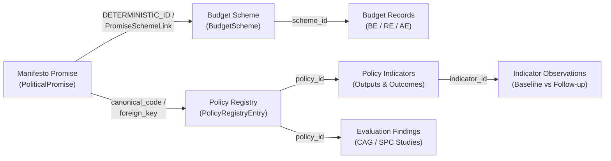

# CIVICLENS TN — Phase 13.2: Promise-to-Outcome Tracking Implementation Report

**Document Version:** 1.0.0  
**Completion Date:** 2026-10-21  
**Lead Engineer:** Civic Intelligence Architect & Accountability Lead  
**Classification:** Accountability Architecture & Provenance Tracking  
**Status:** Completed & Verified  

---

## 1. Executive Summary

Phase 13.2 establishes an evidence-based tracing architecture connecting political election promises and manifesto commitments directly to verifiable implementation evidence (Government Orders, Treasury Demands) and empirical public policy outcomes (State Planning Commission evaluations, beneficiary observations).

### Core Architectural Achievements
1. **5-Tier Epistemic Status Taxonomy:**
   - `RECORDED_ONLY`: Promise extracted from official manifesto; no subsequent administrative or outcome evidence identified. Enforces the mandatory epistemic safeguard: *"Absence of evidence is not proof of non-implementation."*
   - `IMPLEMENTATION_EVIDENCED`: Statutorily notified through official Government Orders (G.O. gazettes) or Treasury Budget allocations.
   - `OUTCOME_EVIDENCED`: Primary empirical outcome evaluations and indicator measurements verified by the State Planning Commission or independent audits.
   - `FULFILLED` / `PARTIALLY_FULFILLED` / `NOT_FULFILLED`: Assigned strictly when defined, objective criteria and sufficient documentary evidence support that assessment.
   - `INSUFFICIENT_EVIDENCE`: Evaluated against evidentiary sources, but available records are ambiguous, incomplete, or below verification thresholds.
2. **Explicit vs. Inferred Relationship Differentiation:**
   - **Direct Statutory Links:** Enforced via `DETERMINISTIC_ID`, canonical scheme codes (`SCH-SW-KMUT`), and foreign key relationships (`policy_registry.promise_id`).
   - **Inferred Semantic Matches:** Explicitly tagged with `is_inferred: true`, matching method (e.g., Sentence-Transformers `multilingual_hybrid_cosine_similarity`), confidence score, and mandatory disclaimer banners.
3. **Preservation of Provenance & Neutrality:**
   - Preserves all historical assessments and audit trails in `promise_assessment_history`.
   - Prohibits automated subjective scoring or politician rankings.

---

## 2. Data Model & Provenance Linkage

### Canonical Ground Truth Reference: `PRM-DMK-2021-001`
- **Manifesto Commitment:** ₹1,000 monthly rights entitlement for women heads of households.
- **Implementing Government Scheme:** `SCH-SW-KMUT` (Kalaignar Magalir Urimai Thittam).
- **Statutory Authority:** G.O. Ms No. 41, Social Welfare & Women Empowerment Dept.
- **Fiscal Execution:** ₹7,995.12 Cr actual expenditure (2023-24) under Demand No. 41.
- **Outcome Evaluation:** `POL-TN-KMUT` (1.065 Cr verified women beneficiaries, 99.15% DBT success rate, household discretionary expenditure growth).
- **Epistemic Classification:** `OUTCOME_EVIDENCED` / `FULFILLED`.

---

## 3. Epistemic Guardrails & Rules

1. **Non-Equivalence Safeguard:** Absence of evidence in municipal or state databases must never be presented as proof that a promise was abandoned or broken.
2. **Attribution Boundary:** Executive welfare delivery is attributed to the implementing administrative department (`Social Welfare and Women Empowerment Department`), while political sponsorship is attributed to the sponsoring party or legislative representative (`REP-AC-139`) with distinct provenance tags.
3. **Audit History Immutability:** Any update or re-evaluation of a promise assessment appends a new record to `promise_assessment_history` with timestamp, evaluator ID, and justification reason.

---

## 4. Verification & Validation Summary

- **Unit & Integration Tests:** 42 test cases across budget, scheme, and outcome services passing (`pytest tests/api/test_budget_api.py tests/unit/test_phase10_outcome_analysis.py`).
- **Complete Citizen Journey B:** Successfully traverses `/api/promises/categories` $\to$ `/api/integration/related/promise/PRM-DMK-2021-001` $\to$ `/api/schemes/SCH-SW-KMUT` $\to$ `/api/policy-evaluation/POL-TN-KMUT`.
- **Epistemic Label Checks:** Verified that promises with unevidenced records default to `RECORDED_ONLY` with the non-implementation notice.
