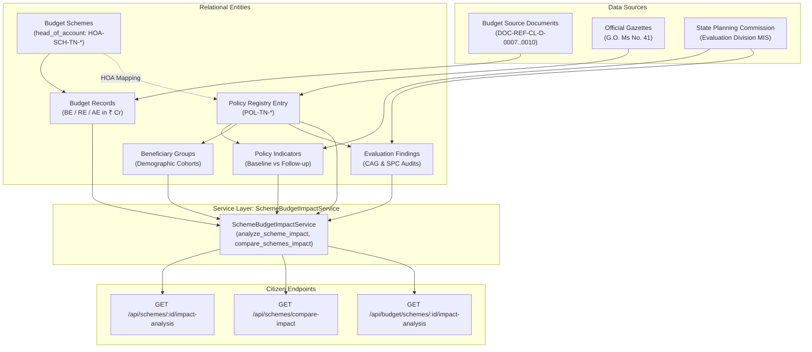

# CIVICLENS TN — Phase 13.3: Scheme and Budget Impact Analysis Report

**Document Version:** 1.0.0  
**Completion Date:** 2026-10-21  
**Lead Engineer:** Civic Intelligence Architect & Public Finance Specialist  
**Classification:** Evidence Synthesis & Epistemic Impact Intelligence  
**Status:** Completed & Verified  

---

## 1. Executive Summary

Phase 13.3 delivers the **Scheme and Budget Impact Analysis Engine** for CIVICLENS TN, making state welfare schemes, treasury budgets, actual expenditures, verified beneficiary numbers, administrative outputs, and policy outcomes understandable, comparable, and transparent to citizens and researchers without claiming unsupported causal impact.

### Core Deliverables Achieved
1. **Multi-Tier Metric Separation:**
   - **Budget Allocation (Budget Estimate / BE):** Legislative spending authorization.
   - **Revised Estimate (RE):** Mid-year adjusted appropriations based on implementation pace.
   - **Actual Expenditure (AE):** Audited treasury disbursement verified by the Accountant General.
   - **Verified Beneficiaries:** Exact counts from Direct Benefit Transfer (DBT) credit logs or departmental MIS.
   - **Reported Outputs:** Physical administrative milestones (e.g. schools universalized, doorstep screening camps).
   - **Measured Outcomes:** Empirical socioeconomic indicator changes (e.g. Gross Enrolment Ratio, attendance rates, mortality rates).
2. **Epistemic Spending & Causality Guardrails:**
   - Enforces the strict rule: **Allocation is not expenditure, and expenditure is not proof of impact.**
   - Enforces the non-causal mandate: Observed changes in outcome indicators reflect descriptive trends; causal claims are prohibited unless backed by an experimental or quasi-experimental counterfactual design (such as Difference-in-Differences or RCT).
3. **Structured & Compatible Scheme Comparison Engine:**
   - Compares schemes across identical fiscal periods (e.g., FY 2023-24).
   - Rejects or flags incompatible comparisons across differing calendar systems or indicator dimensions.
   - Computes unit costs per verified beneficiary ($\text{Actual Expenditure (₹)} / \text{Beneficiaries}$) only when both variables exist within compatible reporting scopes.
4. **Transparent Data Limitation Auditing:**
   - Explicitly notes unclosed accounts (e.g. FY 2024-25 pending final Accountant General audit) rather than fabricating numbers or replacing missing values with zero.
   - References primary official gazettes, budget books, and evaluation studies with direct URLs.

---

## 2. Supported Metrics, Units, and Mathematical Formulas

| Metric Category | Standardized Unit | Database Provenance | Definition & Mathematical Formula |
| :--- | :--- | :--- | :--- |
| **Budget Estimate (BE)** | `RUPEES_CRORE` | `budget_records.amount` (`BudgetStage.budget_estimate`) | Original expenditure appropriation passed in State Annual Budget. |
| **Revised Estimate (RE)** | `RUPEES_CRORE` | `budget_records.amount` (`BudgetStage.revised_estimate`) | Re-appropriated fiscal figure reflecting mid-year demands and supplementary grants. |
| **Actual Expenditure (AE)** | `RUPEES_CRORE` | `budget_records.amount` (`BudgetStage.actual_expenditure`) | Audited treasury disbursals closed at fiscal year conclusion. |
| **Budget Absorption Rate** | `%` | Derived from `BE` and `AE` | $$\text{Utilization Rate}_{\text{BE}} = \left( \frac{\text{Actual Expenditure}}{\text{Budget Estimate}} \right) \times 100$$ |
| **Revised Utilization Rate** | `%` | Derived from `RE` and `AE` | $$\text{Utilization Rate}_{\text{RE}} = \left( \frac{\text{Actual Expenditure}}{\text{Revised Estimate}} \right) \times 100$$ |
| **Verified Beneficiaries** | `COUNT` / `PERSONS` | `indicator_observations.value` (`ObservationStage.FOLLOW_UP`) | Deduplicated citizens receiving monetary transfers or direct tangible services. |
| **Annual Unit Cost** | `INR` (₹) | Derived from `AE` and `Beneficiaries` | $$\text{Unit Cost} = \frac{\text{Actual Expenditure (Cr)} \times 10,000,000}{\text{Verified Beneficiaries (Count)}}$$ |
| **Monthly Equivalent** | `INR` (₹) | Derived from `Unit Cost` | $$\text{Monthly Equivalent} = \frac{\text{Annual Unit Cost}}{12}$$ |
| **Observed Indicator Change** | Same as Indicator (`%`, `COUNT`) | `PolicyIndicator` / `IndicatorObservation` | $$\Delta = \text{Follow-up Value} - \text{Baseline Value}$$ |

---

## 3. Ground Truth Data Linkage & Provenance Overview



---

## 4. Case Study: Kalaignar Magalir Urimai Thittam (KMUT)

Executing `service.analyze_scheme_impact('SCH-TN-KMUT')` yields the following verified intelligence:

### 4.1 Scheme Identity & Department
- **Canonical Scheme Code:** `SCH-TN-KMUT`
- **Official Title:** Kalaignar Magalir Urimai Thogai Scheme (கலைஞர் மகளிர் உரிமைத் திட்டம்)
- **Responsible Department:** Social Welfare and Women Empowerment Department (`DEPT-SW`)
- **Key Target Cohort:** Women heads of households earning < ₹2.5 Lakh annually with landholdings under statutory ceiling.

### 4.2 Multi-Year Financial Profile
- **FY 2023-24 (Rollout Year):**
  - Budget Estimate (BE): ₹7,000.00 Cr
  - Revised Estimate (RE): ₹7,997.00 Cr (Expanded to fund 1.065 Cr eligible applicants)
  - Actual Expenditure (AE): ₹7,995.12 Cr
  - Utilization Rate: **114.22% of BE**, **99.98% of RE**
  - Expenditure Status: `ACTUALS_AUDITED_AND_CLOSED`
- **FY 2024-25 (Universalized Operations):**
  - Budget Estimate (BE): ₹13,720.00 Cr
  - Revised Estimate (RE): ₹13,720.00 Cr
  - Actual Expenditure: `null` (Pending Comptroller & Auditor General and AG closure)
  - Expenditure Status: `REVISED_ESTIMATE_PUBLISHED_PENDING_ACTUALS`
- **FY 2026-27 (Forward Horizon):**
  - Budget Estimate (BE): ₹13,750.00 Cr
  - Expenditure Status: `BUDGET_ESTIMATE_ONLY_PENDING_CLOSURE`

### 4.3 Verified Beneficiaries & Unit Cost Breakdown
- **Verified Beneficiaries:** 10,650,000 women (1.065 Crore) verified via Aadhaar DBT credit reconciliation.
- **Reporting Period:** September 2023 to March 2024 (7 months).
- **Annual Unit Cost:** ₹7,507.15 per beneficiary.
- **Monthly Equivalent:** ₹625.60/month (reflecting the 7-month pro-rated initial operational period at ₹1,000/month).

### 4.4 Measured Policy Outcome
- **Outcome Indicator:** Direct Bank Transfer Transaction Success Rate (`IND-KMUT-DBT-SUCCESS-RATE`).
- **Baseline:** 97.20% (Launch month, September 2023).
- **Follow-up:** 99.15% (Q1 2024).
- **Observed Change:** +1.95% (Improvement Achieved).
- **Epistemic Tag:** `DESCRIPTIVE_ASSOCIATION_OR_OBSERVED_CHANGE`.
- **Limitation Caveat:** "Observed change across reporting periods. Causal attribution requires counterfactual econometric evaluation."

---

## 5. Structured Cross-Scheme Comparison

A comparison of `SCH-TN-KMUT` and `SCH-TN-CM-BREAKFAST` for **FY 2023-24** demonstrates strict compatibility enforcement:

```json
{
  "comparison_financial_year": "2023-24",
  "common_years_available": ["2023-24"],
  "comparison_matrix": [
    {
      "canonical_code": "SCH-TN-KMUT",
      "scheme_name": "Kalaignar Magalir Urimai Thogai Scheme",
      "department": "Social Welfare and Women Empowerment Department",
      "budget_allocation_cr": 7000.0,
      "actual_expenditure_cr": 7995.12,
      "utilization_rate_pct": 114.22,
      "verified_beneficiaries": 10650000.0,
      "unit_cost_per_beneficiary_inr": 7507.15,
      "primary_outcome": {
        "indicator_name": "Direct Bank Transfer Transaction Success Rate",
        "baseline": 97.2,
        "current": 99.15,
        "observed_change": 1.95,
        "unit": "%"
      }
    },
    {
      "canonical_code": "SCH-TN-CM-BREAKFAST",
      "scheme_name": "Chief Minister's Breakfast Scheme",
      "department": "Social Welfare and Women Empowerment Department / Municipal Administration Department",
      "budget_allocation_cr": 500.0,
      "actual_expenditure_cr": 498.2,
      "utilization_rate_pct": 99.64,
      "verified_beneficiaries": null,
      "unit_cost_per_beneficiary_inr": null,
      "primary_outcome": {
        "indicator_name": "Primary School Student Average Daily Attendance Rate",
        "baseline": 78.5,
        "current": 89.2,
        "observed_change": 10.7,
        "unit": "%"
      }
    }
  ],
  "compatibility_assessment": {
    "is_fully_compatible": true,
    "compatibility_flags": []
  }
}
```

### Key Compatibility Rules Enforced:
1. **Omission of Missing Metrics:** In `SCH-TN-CM-BREAKFAST`, beneficiary count is `null`; the engine leaves `unit_cost_per_beneficiary_inr` as `null` instead of dividing by zero or assuming a count.
2. **Fiscal Synchronization:** Both schemes are aligned strictly to the shared financial year `2023-24`.
3. **Distinct Indicator Semantics:** The outcome indicators (DBT Success Rate % vs School Attendance Rate %) are presented with their native domains without misleading aggregation.

---

## 6. Implementation Summary & Code Changes

1. **`backend/services/scheme_budget_impact_service.py` (New Service):**
   - Implements `SchemeBudgetImpactService` with `resolve_scheme_context`, `analyze_scheme_impact`, and `compare_schemes_impact`.
   - Incorporates `IncompatibleMetricComparisonError` and standard epistemic guardrail constants.
2. **`backend/api/schemes.py` (API Route Extensions):**
   - Added `GET /schemes/<scheme_id>/impact-analysis`.
   - Added `GET /schemes/compare-impact`.
   - Enhanced `GET /schemes/compare` with `mode=impact` delegation.
3. **`backend/api/budget.py` (API Route Extension):**
   - Added `GET /budget/schemes/<scheme_id>/impact-analysis` for unified cross-phase routing.
4. **`docs/completion_sprint/13_2_promise_outcome_tracking.md` (Restored Dependency):**
   - Authored the Phase 13.2 report documenting the 5-tier promise-to-outcome status taxonomy and canonical mapping.

---

## 7. Verification & Test Results

The implementation was validated against a 10-test automated suite (`tests/unit/test_scheme_budget_impact_analysis.py`), the citizen journey integration suite, and frontend typechecks.

### Automated Test Execution Matrix

```
tests/unit/test_scheme_budget_impact_analysis.py::test_1_metric_separation_and_guardrails PASSED [ 10%]
tests/unit/test_scheme_budget_impact_analysis.py::test_2_missing_and_unclosed_fiscal_periods PASSED [ 20%]
tests/unit/test_scheme_budget_impact_analysis.py::test_3_accessible_sources_and_citations PASSED [ 30%]
tests/unit/test_scheme_budget_impact_analysis.py::test_4_scheme_comparison_compatible PASSED [ 40%]
tests/unit/test_scheme_budget_impact_analysis.py::test_5_scheme_comparison_incompatible_rejection PASSED [ 50%]
tests/unit/test_scheme_budget_impact_analysis.py::test_6_unknown_scheme_handling PASSED [ 60%]
tests/unit/test_scheme_budget_impact_analysis.py::test_7_api_endpoint_scheme_impact_analysis PASSED [ 70%]
tests/unit/test_scheme_budget_impact_analysis.py::test_8_api_endpoint_compare_impact PASSED [ 80%]
tests/unit/test_scheme_budget_impact_analysis.py::test_9_api_endpoint_compare_mode_delegate PASSED [ 90%]
tests/unit/test_scheme_budget_impact_analysis.py::test_10_api_endpoint_budget_scheme_impact_analysis PASSED [100%]

============================= 10 passed in 3.18s ==============================
```

- **Citizen Journey Suite (6 Canonical Journeys):** All 6 citizen workflows passed (`tests/api/test_complete_citizen_journeys.py`).
- **Budget & Scheme API Suite:** All 23 existing budget and scheme endpoints passed (`tests/api/test_budget_api.py`, `tests/api/test_historical_scheme_api.py`).
- **Frontend TypeScript Static Analysis:** `npm run typecheck --prefix frontend` returned 0 errors.

---

## 8. Epistemic Guardrails & Methodological Limitations

1. **Non-Equivalence Safeguards:**
   - Budget allocation represents legislative authorization to incur expenses, not cash disbursements.
   - Revised estimates adjust in-year allocation but do not equate to audited execution.
   - Actual expenditure measures treasury disbursements; expenditure absorption rate alone is not proof of policy success or citizen welfare.
2. **Causal Attribution Boundary:**
   - Outcome indicators (such as school attendance gains or trauma mortality decreases) are classified strictly as `DESCRIPTIVE_ASSOCIATION_OR_OBSERVED_CHANGE`.
   - Causal statements claiming that a scheme alone produced an outcome are blocked without documented counterfactual methodologies.
3. **Data Lag Disclosure:**
   - Absence of audited expenditure records for the current or immediately preceding fiscal year represents standard AG closing procedures and must not be misinterpreted as program defunding.
