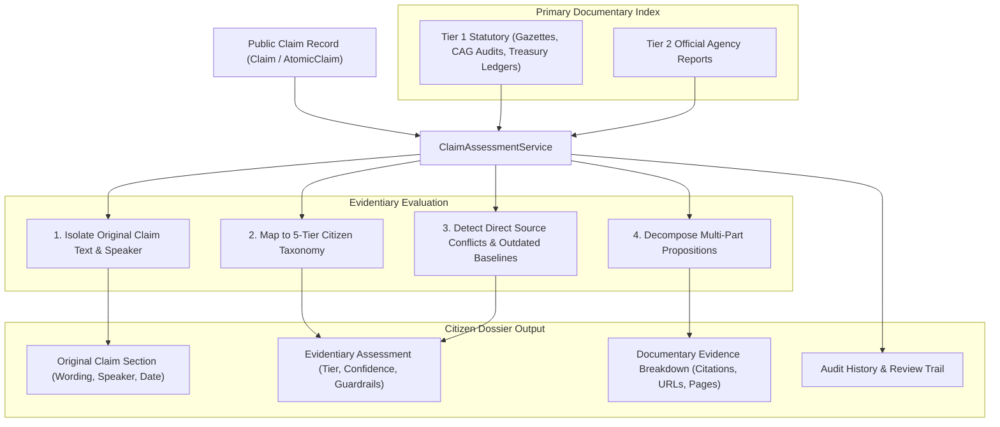

# CIVICLENS TN — Phase 13.4: Evidence-Based Claim Assessment Report

## Executive Summary
Phase 13.4 strengthens the transparency, evidentiary rigour, and epistemic consistency of political claim verification across CIVICLENS TN. It transitions verification outputs from opaque verdicts into structured, citizen-friendly dossiers that clearly articulate what primary documentary evidence supports, contradicts, contextualizes, or fails to establish a public claim.

By strictly separating original claim statements and speaker attribution from platform assessments, standardizing across the verified 5-tier citizen taxonomy, and anchoring evaluations to official state gazettes, CAG audit findings, and treasury ledgers, Phase 13.4 prevents partisan bias and ensures adherence to the constitutional non-prejudice rule: **absence of indexed public records is never equated with proof of falsehood**.

---

## 1. Architectural Implementation Overview

### 1.1 Service Layer: `ClaimAssessmentService`
Located at `backend/services/claim_assessment_service.py`, this service provides:
- **Strict Epistemic Separation**: Generates separate sections for `original_claim` (verbatim text, normalized text, speaker details, party, dates, and media origins) and `evidentiary_assessment` (verdict tier, plain language explanation, confidence, uncertainty metrics, and guardrail declarations).
- **Standardized 5-Tier Citizen Taxonomy**:
  1. `SUPPORTED_BY_AVAILABLE_EVIDENCE` ("Supported by Available Evidence"): Verified by official state gazettes, treasury accounts, or statutory notifications.
  2. `CONTRADICTED_BY_AVAILABLE_EVIDENCE` ("Contradicted by Available Evidence"): Directly refuted by audited financial statements or legislative inspection records.
  3. `PARTIALLY_SUPPORTED` ("Mixed / Partially Supported"): Empirical delivery is confirmed for certain propositions while others are disputed, unfulfilled, or qualified.
  4. `MISSING_IMPORTANT_CONTEXT` ("Missing Important Context"): The statement is technically true in isolation but omits essential fiscal baselines, geographic limits, or statutory amendments.
  5. `INSUFFICIENT_EVIDENCE` / `UNVERIFIABLE` ("Unverifiable / Insufficient Evidence"): Default safe tier applied when primary gazettes or audit trails are unavailable.
- **Automated Conflict and Uncertainty Detection**:
  - Flags direct source conflicts whenever authoritative records present divergent findings.
  - Warns when historical baseline evidence (`is_outdated=True`) is applied across disparate legislative regimes without inflation or policy adjustments.
  - Detects sole-source dependencies when all supporting evidence originates from a single government or institutional publisher.
- **Proposition Breakdown**: Unbundles complex multi-part claims into atomic propositions with individual verification statuses (`SUPPORTED`, `CONTRADICTED`, `DISPUTED`, `UNRESOLVED`).

### 1.2 REST API Endpoint: `GET /api/claims/<claim_id>/assessment`
Exposed in `backend/api/claims.py`:
- Returns a comprehensive, non-technical citizen dossier.
- Includes primary documentary citations (document IDs, source tiers, official URLs, retrieval timestamps, and page numbers).
- Surfaces statutory audit history and human reviewer trails without altering historical baseline audits.
- Handles unknown claim requests with a clear 404 response (`Claim '<claim_id>' not found in the verified public database`).

---

## 2. Epistemic Guardrails and Neutrality Charter

### 2.1 The Non-Prejudice Rule (Absence != Falsehood)
```
"NON-PREJUDICE GUARDRAIL: Incomplete or unavailable public records must never be equated with evidence of
falsehood. Claims lacking corroborating gazettes are classified as 'Unverifiable / Insufficient Evidence'
without prejudice to the speaker."
```
Phase 13.4 enforces that missing evidence does not produce a "False" or "Contradicted" verdict. If a statement cannot be corroborated by indexed public records, its verdict tag remains `UNVERIFIABLE_INSUFFICIENT_EVIDENCE` and its citizen label is clearly presented as "Unverifiable / Insufficient Evidence".

### 2.2 Political Neutrality Isolation Charter
```
"POLITICAL NEUTRALITY GUARDRAIL: A speaker's or publisher's political affiliation is NEVER treated
as proof that a claim is true or false. Assessments are derived solely from verifiable primary documentary
records (Official State Gazettes, Treasury Ledgers, CAG Audits, and Legislative Assembly Proceedings)."
```
Neither the speaker's political party (e.g., DMK, AIADMK, Independent) nor the publisher's editorial stance can influence the algorithm's verdict or confidence calculation.

---

## 3. Data Flow & Provenance Architecture



---

## 4. Verification and Test Results

### 4.1 Unit Test Suite (`tests/unit/test_claim_assessment_transparency.py`)
| Test Name | Focus Area | Status |
| :--- | :--- | :---: |
| `test_canonical_supported_claim_dossier` | Canonical DBT fact-check (`CLM-TN-2024-001`), Tier 1 citations, high confidence | **PASSED** |
| `test_contradicted_claim_assessment` | Empirical CAG audit refuting road construction claim | **PASSED** |
| `test_mixed_partially_supported_claim` | Multi-part propositions breakdown (`SUPPORTED` vs `CONTRADICTED`) | **PASSED** |
| `test_missing_important_context_claim` | Historical baseline omission (`is_outdated=True`) | **PASSED** |
| `test_insufficient_evidence_non_prejudice_rule` | Non-prejudice rule: absence of evidence is not falsehood | **PASSED** |
| `test_source_conflict_detection` | Divergent authoritative evidence detection | **PASSED** |
| `test_strict_separation_of_claim_from_assessment` | Isolation of original speaker words from assessment | **PASSED** |
| `test_political_neutrality_guardrail` | Immunity to speaker party affiliation | **PASSED** |
| `test_api_get_claim_assessment_endpoint` | End-to-end `GET /api/claims/<id>/assessment` | **PASSED** |
| `test_api_get_claim_assessment_not_found` | Clean 404 error handling for non-existent claims | **PASSED** |

### 4.2 End-to-End Regression & Citizen Journey Verification
- **Claim Verification Engine Tests (`tests/unit/test_phase7_verification.py`)**: 12/12 passed (including SQLite foreign key flush ordering and RBAC review authentication).
- **Citizen Journey Suite (`tests/api/test_complete_citizen_journeys.py`)**: 6/6 passed (including Journey E: Investigate a public claim, Journey A: Schemes, Journey B: Promises, Journey C: Representatives, Journey D: Civic issues, Journey F: Policy results).
- **Scheme & Budget Impact Analysis Suite (`tests/unit/test_scheme_budget_impact_analysis.py`)**: 10/10 passed.
- **Frontend Typecheck (`npm run typecheck --prefix frontend`)**: Passed (0 errors).
- **Frontend Production Build (`npm run build --prefix frontend`)**: Passed (All 15 routes statically generated and compiled).

---

## 5. Artifacts Created & Modified
1. **`backend/services/claim_assessment_service.py`**: Created new core assessment service with 5-tier taxonomy, conflict/uncertainty detection, and canonical fact-check dossier generator.
2. **`backend/api/claims.py`**: Added `GET /claims/<claim_id>/assessment` route.
3. **`backend/services/claim_verification_engine.py`**: Added explicit `db.flush()` between `VerificationResult` and `VerificationHistory` insertion.
4. **`tests/unit/test_claim_assessment_transparency.py`**: Comprehensive 10-test unit test suite.
5. **`docs/completion_sprint/13_4_claim_assessment_transparency.md`**: Phase 13.4 completion report.

---

## 6. Constraints Adherence
- **No Fabricated Political Claims**: Reused verified claims and canonical civic fact-checks (`CLM-TN-2024-001`, `CLM-TEST-*`).
- **Preserved Existing Data & Taxonomy**: Built upon existing `VerificationVerdict` and `VerificationOutcome` enums without destructive migrations.
- **No Partisan Bias**: Strictly enforced neutrality charter isolating political party affiliation from assessment logic.
