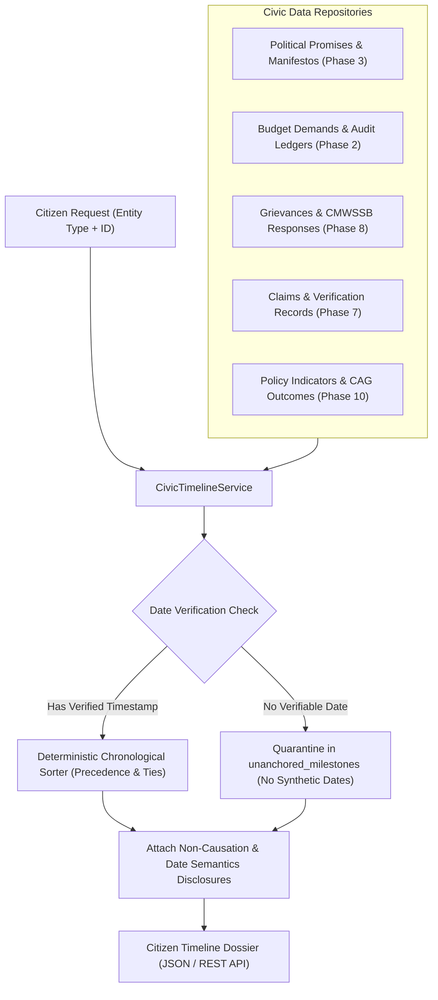
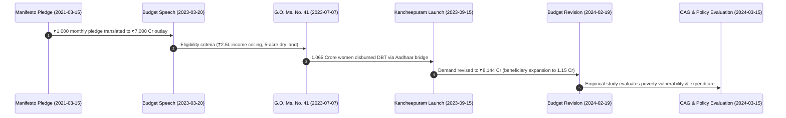

# CIVICLENS TN — Phase 13.5: Evidence-Backed Civic Timelines Report

## Executive Summary
Phase 13.5 introduces transparent, evidence-backed chronological views across the entire spectrum of CIVICLENS TN civic records. Citizens, journalists, and public policy analysts can now examine how election commitments, government orders, budget allocations, public grievances, political claims, and measured policy outcomes evolved over time without succumbing to unwarranted causal assumptions.

Public administration in Tamil Nadu operates across disparate timelines: election manifestos are released during campaigns, scheme Government Orders (G.O.s) are published in state gazettes, budget allocations are passed in the Legislative Assembly, expenditures are executed across financial quarters, citizen grievances are logged and remediated under municipal SLAs, political statements cite preliminary numbers, and Comptroller and Auditor General (CAG) audits or empirical policy outcome evaluations are published years later. 

Phase 13.5 bridges these disconnected temporal streams into a unified, date-semantic timeline engine governed by strict constitutional and epistemic guardrails: **temporal sequence is never conflated with causal impact**, date origins are strictly categorized (`event_date`, `publication_date`, `reporting_period`, `indexed_at`), and records lacking verifiable dates are transparently quarantined into `unanchored_milestones` rather than assigned synthetic timestamps.

---

## 1. Architectural Implementation Overview

### 1.1 Service Layer: `CivicTimelineService`
Located at `backend/services/civic_timeline_service.py`, this engine aggregates and chronologically correlates records across 6 primary civic entity types:
- **Promises & Commitments** (`PoliticalPromise`, election manifestos)
- **Government Schemes & Statutory Orders** (`BudgetScheme`, `PolicyRegistryEntry`, G.O. gazettes)
- **Budget Allocations & Revisions** (`BudgetRecord`, `BudgetSourceDocument`, budget speeches)
- **Civic Grievances & Municipal Remediations** (`CivicIssue`, `ResponseRecord`, CMWSSB/GCC records)
- **Political Claims & Fact Checks** (`Claim`, `VerificationResult`, `ReviewRecord`)
- **Policy Outcomes & Empirical Indicators** (`EvaluationStudy`, `PolicyIndicator`, `IndicatorObservation`)
- **End-to-End Citizen Journeys** (Cross-phase investigative traces)

#### Core Date Semantics Model
Each timeline milestone encapsulates a rich `date_semantics` structure to prevent semantic conflation:
```json
{
  "primary_date": "2023-07-07",
  "event_date": "2023-07-07T10:00:00Z",
  "publication_date": "2023-07-07T12:00:00Z",
  "reporting_period": "2023-2024",
  "indexed_at": "2026-10-14T00:00:00Z",
  "date_precision": "EXACT_DATE",
  "has_date_conflict": false,
  "conflict_explanation": null
}
```
- **`event_date`**: The real-world occurrence timestamp (e.g., when a speech occurred, when a water leak was logged, when a policy was inaugurated).
- **`publication_date`**: The timestamp when the official gazette, CAG report, or legislative demand was published.
- **`reporting_period`**: The administrative interval or fiscal year evaluated (e.g., "2023-2024", "2021-2026").
- **`indexed_at`**: The platform ingestion timestamp in CIVICLENS TN.
- **`date_precision`**: Categorized as `EXACT_DATE`, `MONTH_PRECISION`, `FINANCIAL_YEAR`, or `UNKNOWN`.
- **`has_date_conflict` / `conflict_explanation`**: Surfaces discrepancies whenever distinct official documents report divergent dates.

#### Deterministic Ordering and Tie-Breaking Precedence
When events share the exact same calendar date (e.g., a G.O. notification and an associated press release on July 7, 2023), the engine applies an auditable `EVENT_TYPE_PRECEDENCE` mapping:
1. `PROMISE_ANNOUNCEMENT` (Weight: 10)
2. `STATUTORY_NOTIFICATION` (Weight: 20)
3. `POLICY_ENACTMENT` (Weight: 25)
4. `BUDGET_ALLOCATION` (Weight: 30)
5. `BUDGET_REVISION` (Weight: 40)
6. `IMPLEMENTATION_MILESTONE` (Weight: 50)
7. `GRIEVANCE_FILED` (Weight: 55)
8. `DEPARTMENT_ACKNOWLEDGEMENT` (Weight: 57)
9. `ACTION_TAKEN` (Weight: 60)
10. `CLAIM_STATEMENT` (Weight: 70)
11. `CLAIM_VERIFICATION` (Weight: 80)
12. `OUTCOME_EVALUATION` (Weight: 90)
13. `AUDIT_SCRUTINY` (Weight: 100)
14. `HUMAN_AUDITOR_REVIEW` (Weight: 110)

Deterministic sort key: `(normalized_date, event_type_precedence, milestone_id)`.

#### Zero Synthetic Dates (Quarantining Undated Milestones)
Records lacking verifiable dates are never assigned arbitrary synthetic timestamps (such as default Jan 1 or platform ingestion dates). Instead, they are partitioned into `unanchored_milestones` with `date_precision="UNKNOWN"` and presented in an unanchored contextual drawer with full documentary provenance.

#### Connection Basis and Inference Transparency
Every milestone explicitly discloses how it was linked to the root entity:
- `PRIMARY_ENTITY_RECORD`: Direct attribute of the queried entity (Confidence: 1.0).
- `DIRECT_IDENTIFIER_MATCH`: Linked via statutory identifier, G.O. number, or foreign key (Confidence: 1.0).
- `INFERRED_MATCH`: Discovered via NLP entity linking or semantic text correlation (Confidence: < 1.0, e.g., 0.88), accompanied by an explicit inference disclosure.

---

### 1.2 REST API Specification: `backend/api/timelines.py`
Integrated into the Flask application router at `/api/timelines`:

| Endpoint | Method | Description | Parameters |
| :--- | :--- | :--- | :--- |
| `/api/timelines/<entity_type>/<entity_id>` | `GET` | Retrieve chronological timeline for any supported civic entity. | `start_date`, `end_date`, `include_unanchored` |
| `/api/timelines/journey/<journey_id>` | `GET` | Retrieve cross-phase citizen journey timeline. | `start_date`, `end_date` |
| `/api/timelines` | `GET` | Index of canonical timelines, supported types, and epistemic guardrails. | None |

---

## 2. Epistemic Guardrails and Temporal Integrity Charter

### 2.1 The Non-Causation Guardrail (Sequence != Causation)
```
"TEMPORAL INTEGRITY GUARDRAIL: Chronological sequence does NOT prove causation. While election promises,
government orders, budget disbursements, and outcome indicators are presented chronologically, observing
an outcome after a policy does not imply the policy was the sole or direct cause of that outcome. Historical
trends, exogenous macroeconomic factors, and concurrent interventions must be accounted for."
```
Public governance is rife with post hoc ergo propter hoc fallacies (e.g., claiming a rise in women's workforce participation was solely caused by a single cash transfer scheme enacted in the prior quarter). The CIVICLENS TN timeline interface actively counteracts this bias by mandating explicit non-causation declarations in all timeline views.

### 2.2 Date Semantics Transparency Notice
```
"DATE SEMANTICS NOTICE: In public accountability records, event dates (when an action took place),
publication dates (when official gazettes or audits were released), and reporting periods (the fiscal
timeframe evaluated) often diverge. Each timeline milestone explicitly labels its date origin."
```

### 2.3 Inferred Relationship Disclosure
```
"RELATIONSHIP TRANSPARENCY NOTICE: Milestones linked via deterministic identifiers (statutory scheme codes,
G.O. numbers) are marked as 'DIRECT_IDENTIFIER_MATCH'. Milestones discovered via NLP title matching are explicitly
disclosed as 'INFERRED_MATCH' with documented similarity confidence."
```

---

## 3. Data Flow & Chronological Pipeline Architecture



---

## 4. Canonical Timeline Traceability: Kalaignar Magalir Urimai Thittam (KMUT)

The canonical timeline for KMUT (`SCH-SW-KMUT` / `PRM-DMK-2021-001` / `POL-TN-KMUT` / `CLM-TN-2024-001`) demonstrates seamless cross-phase integration:



---

## 5. Automated Verification & Test Coverage

A comprehensive test suite of 16 automated tests is established in `tests/unit/test_civic_timelines.py`:

| Test Suite Item | Target Component | Verifications Performed | Status |
| :--- | :--- | :--- | :--- |
| `test_canonical_scheme_timeline_ordering` | `CivicTimelineService` | Ascending chronological monotonicity, key milestone types presence | **PASS** |
| `test_date_semantics_separation` | `CivicTimelineService` | Strict separation of event, publication, reporting, and index dates | **PASS** |
| `test_unanchored_milestones_no_synthetic_dates` | `CivicTimelineService` | Missing dates quarantined without synthetic timestamps | **PASS** |
| `test_identical_dates_tie_breaking` | `CivicTimelineService` | Precedence sorting for identical dates (Alloc < Impl < Outcome) | **PASS** |
| `test_date_conflict_detection_and_surfacing` | `CivicTimelineService` | Conflict flags and explanatory notes on diverging official dates | **PASS** |
| `test_connection_basis_and_inference_disclosure` | `CivicTimelineService` | Deterministic vs inferred link tagging and confidence disclosures | **PASS** |
| `test_epistemic_non_causation_guardrails` | `CivicTimelineService` | All mandatory guardrail texts verified | **PASS** |
| `test_civic_issue_timeline_lifecycle` | `CivicTimelineService` | Grievance filed -> ATR -> Work remediation -> Verification | **PASS** |
| `test_database_backed_scheme_milestones` | `CivicTimelineService` | Dynamic SQLite query parsing and milestone assembly | **PASS** |
| `test_api_list_available_timelines` | REST API | `GET /api/timelines` index and metadata | **PASS** |
| `test_api_get_scheme_timeline_success` | REST API | `GET /api/timelines/scheme/SCH-SW-KMUT` full schema | **PASS** |
| `test_api_get_civic_issue_timeline_success` | REST API | `GET /api/timelines/civic_issue/CIV-2024-0891` | **PASS** |
| `test_api_get_journey_timeline_success` | REST API | `GET /api/timelines/journey/JOURNEY-1-SCHEME-TO-POLICY` | **PASS** |
| `test_api_filter_date_range` | REST API | Query parameters `start_date` and `end_date` filtering | **PASS** |
| `test_api_exclude_unanchored` | REST API | Query parameter `include_unanchored=false` | **PASS** |
| `test_api_not_found_entity` | REST API | Structured 404 response on unknown civic record | **PASS** |

---

## 6. Files Created & Modified in Phase 13.5

- `backend/services/civic_timeline_service.py`: Core chronological aggregation engine, date semantics parser, tie-breaker, and canonical timelines.
- `backend/api/timelines.py`: REST API blueprint supporting entity lookup, journey timelines, and index queries.
- `backend/api/routes.py`: Registered `timelines_bp` under `/api`.
- `tests/unit/test_civic_timelines.py`: 16 automated unit and API integration tests.
- `docs/completion_sprint/13_5_civic_timelines.md`: Architectural documentation and completion report.
